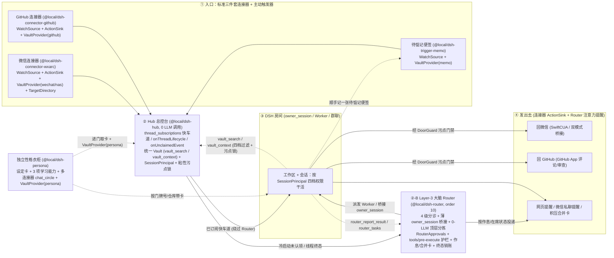
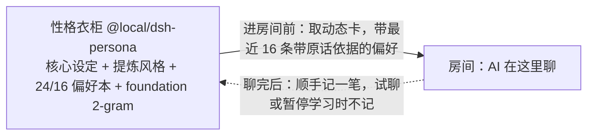
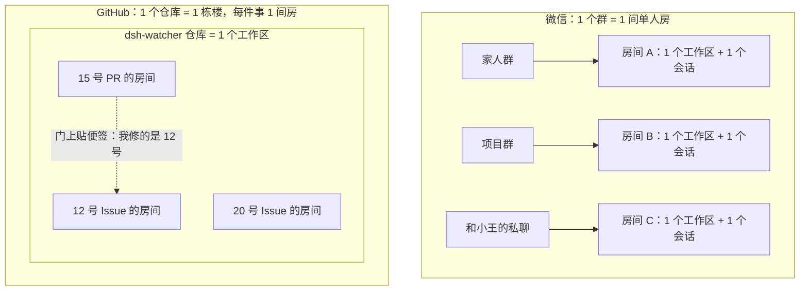
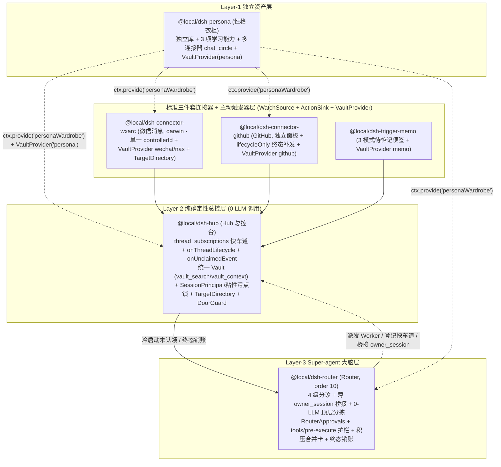

# 01 · 整体框架图

> **一句话：** 这是一台「连接器收消息 → 纯确定性 Hub 总控台分拣（已订阅走快车道 / 终态事件自动销账 / 新事交给 Layer-3 Router 分诊）→ 进 DSH 房间干活（通过 Hub 统一 `Vault` 查只读知识）→ 连接器或注意力路由发消息」的机器。
> 微信是一个双向连接器，GitHub 也是一个双向连接器，「待惦记便签」是一个主动触发器，**「性格衣柜」独立成资产库**供所有模块共用；所有连接器统一遵循 **标准三件套**（`WatchSource` 收事件 + `ActionSink` 发动作 + `VaultProvider` 挂只读数据源）。中间的 **Hub 总控台 100% 确定性、绝不调大模型（0 次 LLM 调用）**，同时承载统一只读知识检索（`vault_search` / `vault_context`、`ctx.provide('vault')`）、内存 `SessionPrincipal` 身份注册与粘性污点锁（Sticky Taint）、跨连接器花名册（`TargetDirectoryProvider`）及线程终态钩子（`onThreadLifecycle`）；架在 Hub 之上的 **`@local/dsh-router`（「Router」）** 则是负责冷启动分诊、薄 `owner_session` 主人私聊桥接、审批护栏（`RouterApprovals` + `tools/pre-execute`）、Worker 派发与作息提醒的 Layer-3 Super-agent 大脑。

本篇只讲「长什么样」。安全与隐私护栏（四档 Vault 可见性、粘性污点锁、`DoorGuard`、审批护栏与无网沙箱）放在 [04-以后再加的安全门禁](./04-以后再加的安全门禁.md)。

---

## 一、一张图看懂全貌



**6 个格子，各干一件事：**

| 格子 | 对应插件 | 干什么 | 打个比方 |
|---|---|---|---|
| ① 入口 / ④ 出口 | `@local/dsh-connector-wxarc`、`@local/dsh-connector-github`、`@local/dsh-trigger-memo` | 按标准三件套接入 Hub：`WatchSource` 报新动静、`ActionSink` 往外发回复、`VaultProvider` 挂只读历史数据（微信还挂 `TargetDirectoryProvider` 花名册） | 门铃 + 快递员 + 档案柜 |
| ② Hub 总控台 | `@local/dsh-hub`（侧边栏「Hub 总控台」） | **0 次 LLM 调用**的纯确定性事件总线与共享底座：查 `thread_subscriptions` 快车道直达；终态事件经 `onThreadLifecycle` 自动销账；冷启动走 `onUnclaimedEvent`；提供 `ctx.provide('vault')`（`vault_search`/`vault_context`）、内存 `SessionPrincipal` 与粘性污点锁、`TargetDirectoryProvider`、统一收件箱、便签本与 `DoorGuard` 草稿箱门禁 | 前台传话员 + 统一查档台 |
| ②-B Router 智能大脑 | `@local/dsh-router`（侧边栏「Router」，order 10） | 架在 Hub 之上的 Layer-3 Super-agent 大脑（`~/.dsh/storages/router/state.sqlite`）：订阅 `onUnclaimedEvent` 与 `onThreadLifecycle` 做 4 级分诊、自动销账与 Worker 派发；维护薄 `owner_session` 桥接与 0-LLM 顶层分拣（无 24h 焦点锁、积压 `≥3` 条合并汇总卡）；统一承接 `RouterApprovals` 确认码审批与 `tools/pre-execute` 护栏 | 值班总调度 + 门岗审批台 |
| ③ DSH 房间 | DSH 工作区 + 会话 | AI 读纸条、经 `vault_search`/`vault_context` 按权限翻资料、看气氛、写回复；Worker 结束时用 `router_report_result` 回报，主人主会话可用 `router_tasks`/`router_send_to_task` 调度任务 | 办公室 |
| 独立性格衣柜 | `@local/dsh-persona`（侧边栏「性格衣柜」） | 把所有性格卡、风格提炼、偏好记忆、`foundation` 检索与跨连接器圈层标注（`chat_circle`）独立存成资产库，并自动桥接为 Hub 的 `VaultProvider('persona')` | 公共衣帽间 + 圈层名录 |

性格设定卡不在 Hub 里写死，也不绑死在某个连接器里，而是**独立放在 `@local/dsh-persona`（「性格衣柜」）**，AI 每次进门时按群名或 GitHub 仓库绑定取一张带上；同时其圈层表（`chat_circle`）原生兼容裸微信 `chatId` 与多连接器前缀（`wxarc:<id>`、`dingtalk:<cid>`、`github:<owner/repo>`，其中 `wxarc:<id>` 与裸 ID 双向回退），成为全系统四档 Vault 可见性的统一判定基准。

### 多连接器统一标准三件套与 0-LLM `Vault` 统一知识入口

每个接入 Hub 的连接器或触发器都按同一套接口挂接，以后新增第 3 个连接器（如钉钉/飞书/Slack）只需实现这三件套即可零改动融入全链路：

| 接口 | 职责 | 当前已注册实现 |
|---|---|---|
| `WatchSource` | 把外部平台新动静（或终态关闭/合并信号）规范化为统一小纸条送入 `hub.ingest(...)` | `connector-wxarc`、`connector-github`、`trigger-memo` |
| `ActionSink` | 接收经 Hub `DoorGuard` 与身份门禁校验后的外发动作 | `wxarc.send`、`github.draft` |
| `VaultProvider` | 暴露只读 `search(query, scope)` 与可选 `context(itemId, opts, scope)`，挂进 Hub 的 `ctx.provide('vault')` 统一查档 | `persona`（性格与事实记忆）、`wechat`（本地近期微信）、`nas`（NAS 微信归档）、`github`（Issue/PR 快照与近期事件）、`memo`（便签提醒） |

- **全局只读工具**：Hub 向 DSH 统一挂载 `vault_search`（默认返回 10 条、上限 20 条，单条 `snippet ≤ 220` 字）与 `vault_context`（默认前后窗口各 5 条、上限 15 条），**0 次 LLM 调用**。
- **四档可见性 + 双重过滤 + 粘性污点锁**：Hub 基于纯内存 `SessionPrincipal` 计算当前会话允许访问的可见性集合（`tier 0` 禁止、`tier 1` 仅 `external`、`tier 2` `external + work`、`tier 3` 全部含 `family + owner_private`），既透传 `allowedCircles` 给各 `VaultProvider`，又在 Hub 聚合层做二次过滤；未标注的微信/NAS/便签数据一律默认归 `owner_private`；一旦命中任意非 `external` 资料，立刻对根会话（及子代理的 `rootSessionId`）打上**粘性污点锁（Sticky Taint）**并记 `turnPrivateRead`，外发时由 `DoorGuard` 强制退回草稿箱并附公网警告，细节见 [04-以后再加的安全门禁](./04-以后再加的安全门禁.md)。
- **跨连接器共享能力**：除 `Vault` 外，Hub 还提供纯确定性的 `TargetDirectoryProvider`（统一群聊/目标花名册解析，当前由 `connector-wxarc` 注册）与 `onThreadLifecycle` 线程终态钩子（`closed`/`merged`/`ended` 自动销账，支持 `lifecycleOnly: true` 纯销账不唤醒 Worker）。

### 独立「性格衣柜」不是死文本：完整保留 3 项学习本事

`@local/dsh-persona`（`~/.dsh/storages/persona/state.sqlite`，首次启动自动从旧 `watcher/state.sqlite` 与 `wxarc-listener/events.sqlite` 无损迁移）通过 `ctx.provide('personaWardrobe')` 和 `/local-persona/*` 向微信和 GitHub 统一提供这 **3 项原 wxarc 学习本事** + 试聊能力：

| 本事 | 怎么做 | 边界 |
|---|---|---|
| ① 学你的说话风格 | 喂一批你本人发过的旧消息，提炼句长、措辞、语气 | 之后只带提炼结果，不每次塞原文 |
| ② 聊着聊着记住偏好 | 按「性格 + 房间」分开记对方明说的偏好与**原话依据** | 最多留 **24 条**，每次带最近 **16 条**；能手改、能清空；不擅自改核心设定 |
| ③ 本人私用 `foundation` 检索 | 对你导入的个人背景资料做 **CJK 2-gram** 检索，回答时按相关性召回 | **仅本人私用**，绝不向群友或外部公开上下文泄露 |
| 试聊看看 | 调语气时在「性格衣柜」里先跟它聊几句 | 不发真消息，也不写进记忆本 |

例子：微信摸鱼群记住「群友讨厌狗头表情」；GitHub `dsh-watcher` 仓库绑定「代码审查员」卡并记住「维护者喜欢先看复现步骤」。两边各记各的，互不串。



微信面板（「微信消息」）与 GitHub 面板（「GitHub」）都不重复做性格编辑器，只在各自面板放一个精简版性格下拉框 + **「去性格衣柜编辑」一键跳转按钮**，所有编辑、学风格、看记忆、导入 `foundation` 和试聊全部收口到独立侧边栏 **「性格衣柜」**。

### 三类入口，走同一条路

| 入口类型 | 例子 | 谁按的门铃 |
|---|---|---|
| **被动收消息** | 群里有人 @、Issue/PR 下有新评论或 👍 点赞 | 别人（经微信或 GitHub 双向连接器） |
| **短期待惦记** | 周五问一句演示顺不顺利；昨天聊过的新闻查后续 | `@local/dsh-trigger-memo`（房间自己写的便签，几小时到几天就用完） |
| **长期蹲守** | Issue #223 等 Gemini 官方正式支持 ACP | 长期便签每 3–7 天查一次，加上 GitHub 评论区一直有人看着 |

三类入口写出来的小纸条格式一样，后面的 Hub 总控台、房间和外发出口一步都不用改。

---

## 二、小纸条长什么样

所有连接器和触发器都写**同一种格式**的小纸条，Hub 总控台只认这一种。

```text
来自：    微信（connector-wxarc）
门牌号：  微信 / 项目群
谁说的：  小王
说了什么：@AI 明天几点开会？
```

```text
来自：    GitHub（connector-github）
门牌号：  GitHub / dsh-watcher / 12 号 Issue
谁说的：  octocat
说了什么：登录页点了没反应
```

```text
来自：    待惦记便签（trigger-memo，周三写的，周五 19:17 到点）
门牌号：  微信 / 摸鱼群
谁说的：  便签
说了什么：小李今天产品演示，先看一眼群里，再决定问不问
```

Hub 总控台不需要懂微信，也不需要懂 GitHub，更分不出纸条是人写的还是便签写的。它先查 `thread_subscriptions` 快车道路由表，命中就直达原房间（完全绕过 Router）；没命中就把冷启动纸条交给 `onUnclaimedEvent` 上的 `@local/dsh-router` 做分诊与派发，未拦截时再按「门牌号」落房。

---

## 三、微信和 GitHub：房间分法不一样



**微信很简单：** 一个群就是一间房，一直住下去。群里每天的聊天都在同一个会话里接着聊。

**GitHub 多一层：** 一个仓库是一栋楼（一个工作区，代码都在这儿）。楼里每件事（每个 Issue、每个 PR）各住一间房（一个会话）。

**两件事有关系时，二选一：**

| 情况 | 怎么办 | 例子 |
|---|---|---|
| 其实是同一件事 | **合住**：搬进同一间房 | PR 说明里写了「修复 12 号 Issue」 |
| 只是有点关系 | **贴便签**：各住各的，门上互相贴一张「隔壁有相关的事」 | PR 评论里顺口提了一句 20 号 Issue |
| 没关系 | 各住各的 | — |

规则就一句话：**新事建新房，旧事回旧房，同一件事合住，沾边的事贴便签。**

> 门上的「便签」是两间房互相提醒；「待惦记便签」是房间给自己记的待办。两种都是纸条，用处不同。

---

## 四、合还是分？为什么拆成 6 个运行时插件 + 1 个聚合包

以前曾经把性格衣柜、GitHub 设置和总调度揉在一起，结果改 GitHub 面板会动到总控台、调性格又和微信/GitHub 互相耦合；现在连智能分诊与注意力调度也单独放到 Layer-3 的 `@local/dsh-router`，让底层 Hub 永远保持 0 次 LLM 调用的纯确定性：



**「纯确定性 Hub」的标准：** `@local/dsh-hub` **0 次 LLM 调用**、**0 新增数据库表**，只做 6 件事，多一件都不做：

1. 收小纸条（只认一种统一格式），记录统一收件箱与去重；识别终态事件（`.closed`/`.merged`/`payload.state === 'closed'`/`payload.merged === true`/`payload.lifecycleOnly === true`）并派发 `onThreadLifecycle`（`lifecycleOnly: true` 仅销账，不唤醒 Worker）
2. 先查 `thread_subscriptions` 快车道路由表，命中直达原房间（完全绕过 Router）；未认领事件触发 `onUnclaimedEvent` 交给 `@local/dsh-router`，未拦截时再按门牌号找房间或新建
3. 同一间房一次只干一件事，后来的排队
4. 提供 `ctx.provide('vault', service.vault)` 与全局只读工具 `vault_search` / `vault_context`，结合纯内存 `SessionPrincipal` 执行四档双重可见性过滤并维护粘性污点锁（Sticky Taint）与 `turnPrivateRead`
5. 提供跨连接器花名册 `TargetDirectoryProvider`（`registerTargetDirectory` / `resolveTarget` / `listTargets`）、统一便签本视图与 `DoorGuard` 草稿箱硬门禁（污点会话强退草稿箱 + 公网警告）
6. 把回复交回给对应的双向连接器 `ActionSink` 发出去

它**不**调大模型，**不**托管性格卡数据库，**不**认识微信界面，**不**认识 GitHub 接口，**不**决定便签该不该开口。

**「Layer-3 大脑 Router」的标准：** `@local/dsh-router`（`id: router`，侧边栏 **「Router」** order 10，状态库 `~/.dsh/storages/router/state.sqlite`）只站在 Hub 上面做 5 件事：

1. **接冷启动 + 线程终态销账 + Worker 回报**：订阅 `hub.onUnclaimedEvent(...)`、`hub.onThreadLifecycle(...)`（PR/Issue 关闭或合并时自动将未决决策置 `resolved`、延迟通知置 `read` 并清 `sessionTurnOverride`）与 Worker 经 `router_report_result` 回报的结论；已登记快车道的旧线索不经过 Router。
2. **4 级分诊 + 程序硬护栏 + Worker 四档沙箱**：按 `ignore` / `inform` / `prepare` / `act` 分诊；代码护栏永远覆盖大模型判断（`actor.isBot -> ignore`、紧急永不忽略、`untrusted` 封顶 `prepare`、模型出错自动 **fail-open** 保底通知），被忽略的条目随时可一键点 **「仍然通知」** 恢复；Worker 按来源四档注册（公开陌生人 1 / 工作私有源 2 / 主人发起 3）并挂接原生无网沙箱（`prepare -> read-only` / `act -> workspace-write`）。
3. **无焦点锁作息路由 + 积压合并汇总卡**：彻底移除 24 小时焦点锁；按 `work` / `off_hours` / `weekend` 时段、`auto` / `present` / `away` 在席状态与紧急直达覆盖决定投递；60 秒幂等延迟巡检在积压 `≥ 3` 条时自动合并为 **1 张无锁摘要卡**；内置 **「情境预演」** 试跑规则。
4. **薄 `owner_session` 桥接 + 0-LLM 顶层分拣**：在独立空工作区 `~/.dsh/workspaces/router-owner` 维护持久化 `owner_session_id`，每次推送卡片静默 `agent.inject()` 写 1 行回执，暴露 `router_tasks` / `router_send_to_task` 桥接工具；主人微信私聊先走 0-LLM 顶层分拣（确认词 → `列表` → `#编号`/引用直达 Worker 并支持单轮临时升权回落 → 1.5s 连发合并异步入 `owner_session`）。
5. **统一审批台 + `tools/pre-execute` 护栏 + 效果统计**：承接 `RouterApprovals`（`router_approvals` / `router_task_uses`，首次只读迁移旧 `wechat_approvals`）与 `tools/pre-execute` 护栏（污点 Worker 断外联、`owner_session` 高危操作与同轮私密读 `web_fetch` 触发 8 位微信确认码）；提供 `/local-router/*` 接口、7d/30d 效果统计与 4 标签页 Web UI。

> 整套系统现在落成 **6 个运行时插件 + 1 个聚合包**：
> - `@local/dsh-persona`（`id: persona`，侧边栏 **「性格衣柜」**）
> - `@local/dsh-hub`（`id: hub`，侧边栏 **「Hub 总控台」**，0 LLM + 统一 `Vault`）
> - `@local/dsh-router`（`id: router`，侧边栏 **「Router」** order 10，Layer-3 Super-agent 大脑）
> - `@local/dsh-connector-github`（`id: connector-github`，侧边栏 **「GitHub」**，独立面板 + 原生 GitHub App）
> - `@local/dsh-connector-wxarc`（`id: connector-wxarc`，侧边栏 **「微信消息」**，仅 macOS `darwin`）
> - `@local/dsh-trigger-memo`（`id: trigger-memo`，3 模式主动待惦记便签引擎）
> - `@local/dsh-hub-bundle`（一键汇总安装以上 6 个插件，并承载跨包端到端测试）
>
> 等以后要加第 3 个连接器（比如钉钉/飞书/Slack），按 `WatchSource + ActionSink + VaultProvider` 标准三件套直接插到 Hub 总线上就行，零改动核心。

---

## 五、哪些放公共层，哪些各自管

| 事情 | 公共层负责 | 留给各自连接器或触发器 |
|---|---|---|
| 性格设定、风格提炼、24/16 偏好、私用 `foundation` 与圈层标注 | `@local/dsh-persona`（「性格衣柜」统一存放，多连接器 `chat_circle` 前缀兼容，并自动挂为 `VaultProvider('persona')`） | 微信、GitHub 与 Router 按需取性格卡与圈层判定，连接器面板支持一键跳转衣柜编辑 |
| 收消息与终态通知 | `@local/dsh-hub` 统一收小纸条并检测 `onThreadLifecycle`（支持 `lifecycleOnly` 纯销账） | 各连接器实现 `WatchSource`：微信连接器读微信并异步旁路预处理主人多模态；GitHub 连接器留存 `/connector/github/events` 并为自发/Bot PR 关闭补发 `lifecycleOnly`；便签引擎到点写纸条 |
| 统一只读查档（Vault）与身份/污点锁 | `@local/dsh-hub` 暴露 `ctx.provide('vault')` + `vault_search`/`vault_context`，管纯内存 `SessionPrincipal`、四档双重过滤、粘性污点锁与 `TargetDirectoryProvider` | 各插件实现只读 `VaultProvider`（`persona`/`wechat`/`nas`/`github`/`memo`），微信额外注册 `TargetDirectoryProvider` 花名册 |
| 快车道直达与房间排队 | `@local/dsh-hub` 先查 `thread_subscriptions` 直达（0 LLM），同房串行 + `DoorGuard`（含污点退草稿 + 公网警告）+ 统一草稿箱 | 各自决定门牌号怎么写：微信 = 群名；GitHub = 仓库 + 编号（含合住/贴便签）；便签 = 写它的那间房 |
| 冷启动分诊、主人主会话、审批护栏与作息提醒 | `@local/dsh-router` 管 4 级分诊 + 硬护栏 + 终态销账 + 积压 `≥3` 合并汇总卡 + 薄 `owner_session` 桥接 + 0-LLM 顶层分拣 + `RouterApprovals` + `tools/pre-execute` 护栏 + Worker 无网沙箱 | 连接器只需如实标注 `actor.isBot`、紧急度与可信度（`untrusted` 等）并转发单一主人 `controllerId` 消息，不再自维护管理员会话或抢消费审批词 |
| 主动开口 | `@local/dsh-hub` 照常把便签纸条送进房间，提供统一主体与花名册解析 | `@local/dsh-trigger-memo` 管「记下、到时候、联网核查、写纸条」与主体角色落锁；开不开口由房间先看气氛再定 |
| 发出去 | `@local/dsh-hub` 经 `DoorGuard` 污点与身份门禁后把回复交回对应 `ActionSink` | 微信连接器用 SwiftCUA 串行操作微信发；GitHub 连接器用 GitHub App 发评论/审查 |

---

**下一篇：** [02-消息流转全过程](./02-消息流转全过程.md)：4 条日常路线（其中主动开口有 3 种便签），一条一条走一遍。
