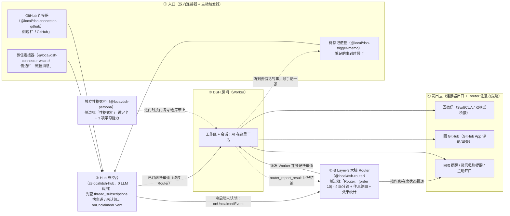
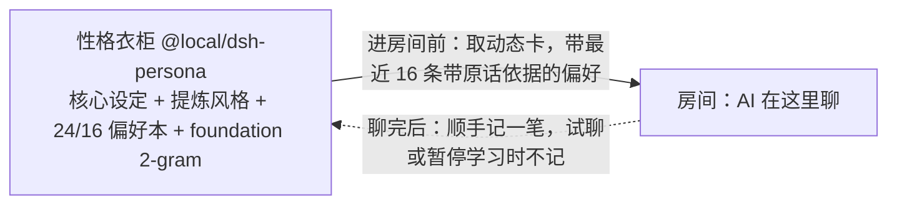
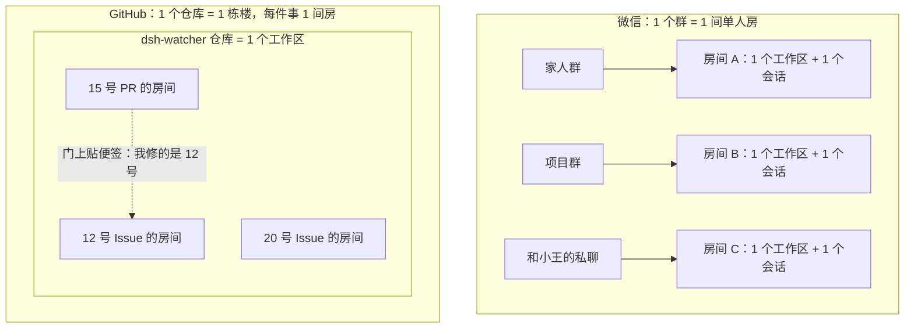
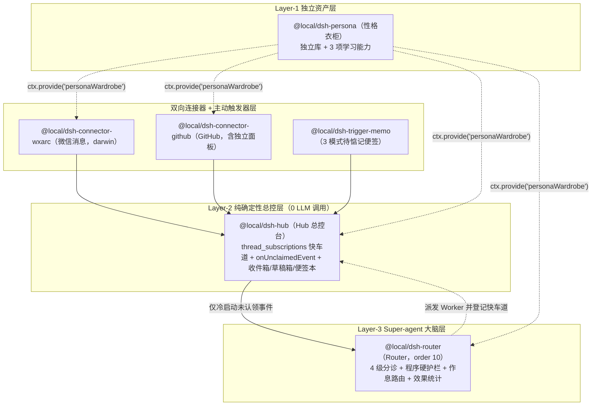

# 01 · 整体框架图

> **一句话：** 这是一台「连接器收消息 → 纯确定性 Hub 总控台分拣（已订阅走快车道 / 新事交给 Layer-3 Router 分诊）→ 进 DSH 房间干活 → 连接器或注意力路由发消息」的机器。
> 微信是一个双向连接器，GitHub 也是一个双向连接器，「待惦记便签」是一个主动触发器，**「性格衣柜」独立成资产库**供所有模块共用；中间的 **Hub 总控台 100% 确定性、绝不调大模型（0 次 LLM 调用）**，架在 Hub 之上的 **`@local/dsh-router`（「Router」）** 则是负责冷启动分诊、Worker 派发与作息提醒的 Layer-3 Super-agent 大脑。

本篇只讲「长什么样」。安全的事先不管，放在 [04-以后再加的安全门禁](./04-以后再加的安全门禁.md)。

---

## 一、一张图看懂全貌



**6 个格子，各干一件事：**

| 格子 | 对应插件 | 干什么 | 打个比方 |
|---|---|---|---|
| ① 入口 / ④ 出口 | `@local/dsh-connector-wxarc`、`@local/dsh-connector-github`、`@local/dsh-trigger-memo` | 发现「有新动静」或「惦记的事到时候了」，写成一张小纸条；干完活再由对应连接器把回复发回去 | 门铃 + 快递员 |
| ② Hub 总控台 | `@local/dsh-hub`（侧边栏「Hub 总控台」） | **0 次 LLM 调用**的纯确定性事件总线：查 `thread_subscriptions` 快车道直达；没命中时通过 `onUnclaimedEvent` 交给 Router；管统一收件箱、便签本、草稿箱硬门禁与排队 | 前台传话员 |
| ②-B Router 智能大脑 | `@local/dsh-router`（侧边栏「Router」，order 10） | 架在 Hub 之上的 Layer-3 Super-agent 大脑（`~/.dsh/storages/router/state.sqlite`）：**只订阅 `hub.onUnclaimedEvent`**，对冷启动新事做 4 级分诊与程序硬护栏、派发 Worker 并登记快车道、收 Worker 经 `router_report_result` 回报的结论，并按你的作息与在席状态决定什么时候发网页或微信提醒 | 值班总调度 |
| ③ DSH 房间 | DSH 工作区 + 会话 | AI 读纸条、翻资料、看气氛、写回复；必要时用 `router_report_result` 把阶段结论交回给 Router | 办公室 |
| 独立性格衣柜 | `@local/dsh-persona`（侧边栏「性格衣柜」） | 把所有性格卡、风格提炼、偏好记忆与 `foundation` 检索独立存成资产库，微信、GitHub 与 Router 各取所需 | 公共衣帽间 |

性格设定卡不在 Hub 里写死，也不绑死在某个连接器里，而是**独立放在 `@local/dsh-persona`（「性格衣柜」）**，AI 每次进门时按群名或 GitHub 仓库绑定取一张带上。

### 独立「性格衣柜」不是死文本：完整保留 3 项学习本事

`@local/dsh-persona`（`~/.dsh/storages/persona/state.sqlite`，首次启动自动从旧 `watcher/state.sqlite` 与 `wxarc-listener/events.sqlite` 无损迁移）通过 `ctx.provide('personaWardrobe')` 和 `/local-persona/*` 向微信和 GitHub 统一提供这 **3 项原 wxarc 学习本事** + 试聊能力：

| 本事 | 怎么做 | 边界 |
|---|---|---|
| ① 学你的说话风格 | 喂一批你本人发过的旧消息，提炼句长、措辞、语气 | 之后只带提炼结果，不每次塞原文 |
| ② 聊着聊着记住偏好 | 按「性格 + 房间」分开记对方明说的偏好与**原话依据** | 最多留 **24 条**，每次带最近 **16 条**；能手改、能清空；不擅自改核心设定 |
| ③ 本人私用 `foundation` 检索 | 对你导入的个人背景资料做 **CJK 2-gram** 检索，回答时按相关性召回 | **仅本人私用**，绝不向群友或外部公开上下文泄露 |
| 试聊看看 | 调语气时在「性格衣柜」里先跟它聊几句 | 不发真消息，也不写进记忆本 |

例子：微信摸鱼群记住「群友讨厌狗头表情」；GitHub `dsh-watcher` 仓库绑定「代码审查员」卡并记住「维护者喜欢先看复现步骤」。两边各记各的，互不串。



微信面板（「微信消息」）与 GitHub 面板（「GitHub」）都不重复做性格编辑器，只在各自面板放一个精简版性格下拉框 + **「去性格衣柜编辑」一键跳转按钮**，所有编辑、学风格、看记忆、导入 `foundation` 和试聊全部收口到独立侧边栏 **「性格衣柜」**。

### 三类入口，走同一条路

| 入口类型 | 例子 | 谁按的门铃 |
|---|---|---|
| **被动收消息** | 群里有人 @、Issue/PR 下有新评论或 👍 点赞 | 别人（经微信或 GitHub 双向连接器） |
| **短期待惦记** | 周五问一句演示顺不顺利；昨天聊过的新闻查后续 | `@local/dsh-trigger-memo`（房间自己写的便签，几小时到几天就用完） |
| **长期蹲守** | Issue #223 等 Gemini 官方正式支持 ACP | 长期便签每 3–7 天查一次，加上 GitHub 评论区一直有人看着 |

三类入口写出来的小纸条格式一样，后面的 Hub 总控台、房间和外发出口一步都不用改。

---

## 二、小纸条长什么样

所有连接器和触发器都写**同一种格式**的小纸条，Hub 总控台只认这一种。

```text
来自：    微信（connector-wxarc）
门牌号：  微信 / 项目群
谁说的：  小王
说了什么：@AI 明天几点开会？
```

```text
来自：    GitHub（connector-github）
门牌号：  GitHub / dsh-watcher / 12 号 Issue
谁说的：  octocat
说了什么：登录页点了没反应
```

```text
来自：    待惦记便签（trigger-memo，周三写的，周五 19:17 到点）
门牌号：  微信 / 摸鱼群
谁说的：  便签
说了什么：小李今天产品演示，先看一眼群里，再决定问不问
```

Hub 总控台不需要懂微信，也不需要懂 GitHub，更分不出纸条是人写的还是便签写的。它先查 `thread_subscriptions` 快车道路由表，命中就直达原房间（完全绕过 Router）；没命中就把冷启动纸条交给 `onUnclaimedEvent` 上的 `@local/dsh-router` 做分诊与派发，未拦截时再按「门牌号」落房。

---

## 三、微信和 GitHub：房间分法不一样



**微信很简单：** 一个群就是一间房，一直住下去。群里每天的聊天都在同一个会话里接着聊。

**GitHub 多一层：** 一个仓库是一栋楼（一个工作区，代码都在这儿）。楼里每件事（每个 Issue、每个 PR）各住一间房（一个会话）。

**两件事有关系时，二选一：**

| 情况 | 怎么办 | 例子 |
|---|---|---|
| 其实是同一件事 | **合住**：搬进同一间房 | PR 说明里写了「修复 12 号 Issue」 |
| 只是有点关系 | **贴便签**：各住各的，门上互相贴一张「隔壁有相关的事」 | PR 评论里顺口提了一句 20 号 Issue |
| 没关系 | 各住各的 | — |

规则就一句话：**新事建新房，旧事回旧房，同一件事合住，沾边的事贴便签。**

> 门上的「便签」是两间房互相提醒；「待惦记便签」是房间给自己记的待办。两种都是纸条，用处不同。

---

## 四、合还是分？为什么拆成 6 个运行时插件 + 1 个聚合包

以前曾经把性格衣柜、GitHub 设置和总调度揉在一起，结果改 GitHub 面板会动到总控台、调性格又和微信/GitHub 互相耦合；现在连智能分诊与注意力调度也单独放到 Layer-3 的 `@local/dsh-router`，让底层 Hub 永远保持 0 次 LLM 调用的纯确定性：



**「纯确定性 Hub」的标准：** `@local/dsh-hub` **0 次 LLM 调用**，只做 5 件事，多一件都不做：

1. 收小纸条（只认一种统一格式），记录统一收件箱与去重
2. 先查 `thread_subscriptions` 快车道路由表，命中直达原房间（完全绕过 Router）；未认领事件触发 `onUnclaimedEvent` 交给 `@local/dsh-router`，未拦截时再按门牌号找房间或新建
3. 同一间房一次只干一件事，后来的排队
4. 统一管理便签本视图与草稿箱硬门禁（`DoorGuard`）
5. 把回复交回给对应的双向连接器发出去

它**不**调大模型，**不**托管性格卡数据库，**不**认识微信界面，**不**认识 GitHub 接口，**不**决定便签该不该开口。

**「Layer-3 大脑 Router」的标准：** `@local/dsh-router`（`id: router`，侧边栏 **「Router」** order 10，状态库 `~/.dsh/storages/router/state.sqlite`）只站在 Hub 上面做 4 件事：

1. **只接冷启动 + Worker 回报**：仅订阅 `hub.onUnclaimedEvent(...)` 与 Worker 通过 `router_report_result` 工具回报的结论；已登记快车道的旧线索不经过 Router，省推理也零延迟。
2. **4 级分诊 + 程序硬护栏**：按 `ignore` / `inform` / `prepare` / `act` 分诊；代码护栏永远覆盖大模型判断（`actor.isBot -> ignore`、紧急永不忽略、`untrusted` 封顶 `prepare`、模型出错自动 **fail-open** 保底通知），被忽略的条目随时可一键点 **「仍然通知」** 恢复。
3. **作息与注意力路由**：根据 `work` / `off_hours` / `weekend` 时段、`auto` / `present` / `away` 在席状态与紧急直达覆盖，决定立刻发网页提醒、转微信私聊还是延后由 60 秒幂等定时器补发；内置 **「情境预演」** 方便提前试跑规则。
4. **效果统计与 4 标签页管理**：提供 `/local-router/*` 接口、7 天 / 30 天效果统计（提醒发送量、过滤数、误滤恢复率、活跃快车道数、推荐选项采纳率）与 4 标签页 Web UI（**待处理 & 分诊** / **网页提醒** / **注意力与作息** / **效果统计 & 快车道**）。

> 整套系统现在落成 **6 个运行时插件 + 1 个聚合包**：
> - `@local/dsh-persona`（`id: persona`，侧边栏 **「性格衣柜」**）
> - `@local/dsh-hub`（`id: hub`，侧边栏 **「Hub 总控台」**，0 LLM）
> - `@local/dsh-router`（`id: router`，侧边栏 **「Router」** order 10，Layer-3 Super-agent 大脑）
> - `@local/dsh-connector-github`（`id: connector-github`，侧边栏 **「GitHub」**，独立面板 + 原生 GitHub App）
> - `@local/dsh-connector-wxarc`（`id: connector-wxarc`，侧边栏 **「微信消息」**，仅 macOS `darwin`）
> - `@local/dsh-trigger-memo`（`id: trigger-memo`，3 模式主动待惦记便签引擎）
> - `@local/dsh-hub-bundle`（一键汇总安装以上 6 个插件，并承载跨包端到端测试）
>
> 等以后要加第 3 个连接器（比如飞书/Slack），直接插到 Hub 总线上就行，零改动核心。

---

## 五、哪些放公共层，哪些各自管

| 事情 | 公共层负责 | 留给各自连接器或触发器 |
|---|---|---|
| 性格设定、风格提炼、24/16 偏好、私用 `foundation` | `@local/dsh-persona`（「性格衣柜」统一存放与编辑） | 微信、GitHub 与 Router 各自按需取性格卡，连接器面板支持一键跳转衣柜编辑；微信导出本机旧消息供提炼 |
| 收消息 | `@local/dsh-hub` 只认统一格式的小纸条 | 微信连接器读微信；GitHub 连接器读 GitHub 并留存 `/connector/github/events` 原始事件流；便签引擎到时候自己写一张 |
| 快车道直达与房间排队 | `@local/dsh-hub` 先查 `thread_subscriptions` 直达（0 LLM），同房串行 + `DoorGuard` + 统一草稿箱 | 各自决定门牌号怎么写：微信 = 群名；GitHub = 仓库 + 编号（含合住/贴便签）；便签 = 写它的那间房 |
| 冷启动分诊、Worker 派发与作息提醒 | `@local/dsh-router` 只订阅 `onUnclaimedEvent` 与 `router_report_result`，管 4 级分诊 + 硬护栏 + 作息路由 + 7d/30d 统计 | 连接器只需如实标注 `actor.isBot`、紧急度与可信度（`untrusted` 等），无需自己实现分诊或打扰时间表 |
| 主动开口 | `@local/dsh-hub` 照常把便签纸条送进房间 | `@local/dsh-trigger-memo` 管「记下、到时候、联网核查、写纸条」；开不开口由房间先看气氛再定 |
| 发出去 | `@local/dsh-hub` 把回复交回对应连接器出口（Router 提醒经网页提醒或微信出口送达） | 微信连接器用 SwiftCUA 串行操作微信发；GitHub 连接器用 GitHub App 发评论/审查 |

---

**下一篇：** [02-消息流转全过程](./02-消息流转全过程.md)：4 条日常路线（其中主动开口有 3 种便签），一条一条走一遍。
