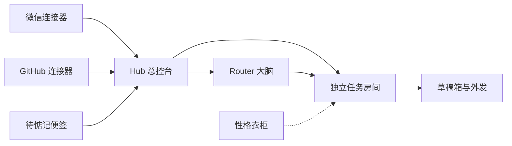

# 01 · 整体长什么样

> 一套把微信、GitHub 和待办便签串起来的个人助理系统，收消息、分轻重、记风格、把好发信关。

如果你第一次打开这套系统，不用急着翻代码，先看清它平时帮你忙活哪些事、里面住着哪六个角色，以及消息是怎么在房间之间流动的。

---

## 一、它平时帮你干什么

日常工作和生活里，消息散落在微信群、代码仓库和脑子里的待办事项中，很容易顾此失彼。这套系统像一位长驻电脑里的管家，帮你把这些事拢在一起：

- **接住多处新动态**：微信群里有人找你、GitHub 仓库冒出新 Issue 或 PR 评论，都会统一收进收件箱，不用频繁切窗口盯屏幕。
- **按场合切换口吻**：家人群聊得轻松、项目群说话干练、代码仓库回复严谨，不同房间各自配一套说话风格，绝不串戏。
- **盯着进度和待办**：需要跟进的代码问题会派专人一跟到底；聊到以后要跟进或要等官宣的事，还能顺手记成便签，到时候看气氛再开口。
- **该安静时安静**：上班在电脑前直接看网页端提醒，下班或离开电脑再转到微信，消息攒多了还会自动合成一张卡片，不叮咚刷屏。
- **发重要消息先过你眼**：往外部仓库或敏感群聊发消息时，默认先存进草稿箱等你拍板，确认没问题再真正发出去。

### 一天里的三个常见片段

- **上午写代码时**：GitHub 仓库冒出一条缺陷报告，大脑判断需要排查，立刻派专人进房间复现并草拟回复，顺手在网页端轻声提醒你，不拿微信打断思路。
- **傍晚出门吃饭**：项目群里同事发来语音问进度，系统先转成文字交给对应房间，又把几条下班后的待办合成一张清爽卡片推到你微信，饭后回一句口令就能批完。
- **周末陪家人时**：非紧急的工作动态先安静攒在队列里；家人群晒出聚会照片，挂着亲友风格的分身认出熟人自然搭话，完全不会把工作群的语气带进来。

---

## 二、六个模块各管哪一摊

整套系统拆成六个分工明确的小模块。你可以把它们想象成一间配合默契的小办公室：



六个模块各自守着自己那一摊，互不越界：

| 模块名称 | 侧边栏入口 | 平时干什么 | 打个比方 |
|---|---|---|---|
| 性格衣柜 | 性格衣柜 | 管说话人设、学你的口吻、记房间偏好和认图卡片 | 公共衣帽间 |
| Hub 总控台 | Hub 总控台 | 收件箱去重、熟事直接放行、管资料库与草稿箱 | 前台总调度 |
| Router 大脑 | Router | 替陌生新消息分轻重、派专人干活、按作息发提醒 | 值班大管家 |
| 微信连接器 | 微信消息 | 监听微信收发消息、翻译语音图片文章、接通档案库 | 微信跑腿员 |
| GitHub 连接器 | GitHub | 盯仓库动态、关联问题与代码变更、发评论和评审 | 仓库观察员 |
| 待惦记便签 | 总控台便签本 | 记下以后要跟进或蹲守的事，到点看气氛主动提醒 | 贴心记事本 |

有一个特别关键的分工原则：**Hub 总控台自己绝不动脑子、也不调用大模型**。它只按铁打的规矩收纸条、查门牌、拦风险和排队；真正需要理解语境、判断轻重缓急的新鲜事，才交给 Router 大脑拿主意。

---

## 三、「统一小纸条」和「独立房间」

看懂下面两个比喻，整套系统的运转逻辑你就摸透八成了。

### 1. 统一小纸条：不管哪来的动静，都抄成同一种格式

微信群聊天、GitHub 评论和到点的待办便签，原本长得完全不一样。每个入口在把动静递给总控台前，都会先把它抄成同一种「小纸条」，写清来源、门牌号、说话人和内容。

| 动静来源 | 日常例子 | 谁按的门铃 |
|---|---|---|
| 被动收消息 | 微信群里有人找你、GitHub 下有新评论或点赞 | 微信连接器或 GitHub 连接器 |
| 短期待惦记 | 周五问一句演示顺不顺利、查昨天聊过的新闻后续 | 待惦记便签 |
| 长期蹲守 | 长期盯某个框架版本正式官宣，有动静再通知 | 待惦记便签 |

不管来自哪一类，交到总控台手里都是同样清爽的小纸条：

```text
来自：    微信
门牌号：  微信 / 项目群
谁说的：  小王
说了什么：@助手 明天上午的评审改到几点？
```

```text
来自：    GitHub
门牌号：  GitHub / 示例仓库 / 12 号 Issue
谁说的：  热心用户
说了什么：登录按钮在暗黑模式下点不动
```

```text
来自：    待惦记便签
门牌号：  微信 / 家人群
谁说的：  便签提醒
说了什么：上周说好这周末提醒订体检，先看看群里聊过没有
```

这样做的好处很实在：后面的总控台、大脑、房间和草稿箱只需要认这一种纸条。哪怕以后再接一个新聊天软件，只需要加一个新的跑腿员，中间整套机器一步都不用大改。

### 2. 独立房间：一事一房，互不串台

纸条进了办公室后，并不会全都堆在同一个聊天框里，而是按门牌号分进各自独立的房间：

- **一个微信群一间房**：家人群和项目群各自住一间，聊天上下文、说话风格和允许看到的资料互不掺和。
- **一个代码问题一间房**：12 号 Issue 有自己的专属房间和工作区，专人从头跟到尾，不会和别的仓库任务混在一起。
- **你的专属私聊也是一间长住房**：你在微信里单独找助理聊天，有自己长期保留上下文的房间，随时接着聊。

所有房间都共用同一个性格衣柜和统一资料库，但每间房能翻出多少历史记录，严格取决于这间房所属的隐私圈层。

---

## 四、接下来看哪篇

本篇只画全景地图，具体每块怎么玩，按你的兴趣挑一篇接着看：

- 想知道新消息怎么分诊、熟事怎么直达、Issue 和 PR 怎么合住一间房，看 [02-日常消息怎么走](./02-日常消息怎么走.md)。
- 想知道怎么在微信里当老板、收合并通知、发口令派活和跨群查档，看 [03-微信上怎么指挥它](./03-微信上怎么指挥它.md)。
- 想知道性格衣柜怎么学你说话、认图记人，以及统一资料库怎么查历史，看 [04-性格衣柜与查资料](./04-性格衣柜与查资料.md)。
- 想知道定时提醒、追新闻后续和长期蹲官宣便签怎么运作，看 [05-待惦记便签怎么主动开口](./05-待惦记便签怎么主动开口.md)。
- 想知道四道安全防线怎么防泄密、防冒充和拦高危操作，看 [06-安全防线与隐私边界](./06-安全防线与隐私边界.md)。
- 想知道回复怎么过草稿箱、微信怎么防止发串群、GitHub 怎么防刷屏，看 [07-消息怎么发出去](./07-消息怎么发出去.md)。
- 想知道怎么安装六个插件、给主机升级更新和日常自检，看 [08-安装部署与日常维护](./08-安装部署与日常维护.md)。
