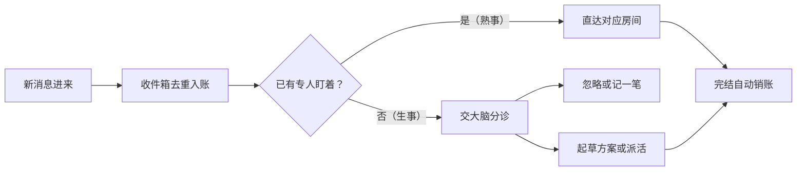

# 02 · 日常消息怎么走

> 一条微信或 GitHub 新消息进来后，怎么去重、走快车道或交大脑分诊，再到房间里收尾。

每天群里的聊天、仓库里的评论和点赞此起彼伏。如果每条动静都让大模型从头琢磨一遍，既慢又吵。下面拆开看看，平时一条新消息进来究竟走了哪几步。

---

## 一、主干流程一览

不管消息来自微信还是 GitHub，进门后都会按下面这条主干流转：



整条路拆成四步：**先进收件箱去重留档，再看是不是熟事；熟事不绕弯直达旧房，生事才请大脑看轻重；事情了结后自动收尾销账。**

哪怕同一个连接器因为网络抖动把同一条消息报了两次，收件箱也会在门口先去重，绝不会让房间重复干两遍活。

---

## 二、熟事快车道 vs 生事四档分诊

### 1. 熟事走快车道：已经有人盯着，直接递进去

举个日常例子，感受一下快车道有多省事：

1. 周一上午，仓库冒出「12 号 Issue」，大脑派了一位专人进 12 号房间跟进，并给这间房挂上了「正在盯防」的门牌。
2. 周二下午，提问题的用户在 12 号 Issue 下补了一段报错日志。
3. 新消息进收件箱后，总控台一眼认出门牌已有人认领，直接把新评论塞进 12 号房间，**完全绕过大脑重新分诊**。
4. 房间里的专人立刻接着昨天的调查进度往下查，既快又不丢上下文。

同一个房间里如果一连串冒出好几条新消息，总控台还会按房间排队依次递进去，防止两条消息在房间里互相打架。

### 2. 生事交大脑分诊：按轻重缓急分四档

如果是从来没见过的新动态，总控台才会递给 Router 大脑看一眼。大脑读完来龙去脉后，会给出下面四档决定之一：

| 档位 | 大脑怎么做 | 日常例子 |
|---|---|---|
| 忽略 | 记个账就翻篇，不打扰你 | 自动化机器人的例行回复、纯客套表情 |
| 告知一声 | 按你的作息发条轻提醒，不派专人 | 有人给你的开源项目点了赞、Issue 被顺手关闭 |
| 准备方案 | 派只读专人进房查背景、起草建议等你定 | 陌生用户提了新功能建议，先调研再草拟回复 |
| 动手处理 | 派专人进工作区动手排查、改稿或跑检查 | 自己仓库的明确缺陷报告，需要定位原因并修补 |

专人查完或干完活后，会把简短结论、待发草稿或截图标好编号交回大脑，再由大脑按你的作息决定现在提醒你还是先攒进队列。

### 3. 三条铁规矩，绝不靠 AI 临场发挥

大脑做判断很灵活，但有三条硬规矩由程序死死托底，大模型说了也不算：

- **机器人发言自动跳过**：自动化账号或机器人自己发的评论一律直接忽略，避免陷入无休止的互相回复。如果你事后想看某条被跳过的动态，可以在网页端一键恢复通知。
- **紧急事件绝不忽略**：被标成紧急的动态永远不会被静音吞掉，保证第一时间送进你的提醒队列。
- **陌生外部动态绝不越权动手**：来自不熟悉外部人员的请求，最高只允许进入「准备方案」档位，先调查起草给你把关，绝不会替你擅自改动代码或直接外发。

万一大模型偶尔卡壳没吐出规矩的判断结果，系统也会走保守兜底：还没关掉的人类代码问题默认升到「准备方案」提醒你，已经关闭的只做轻告知，绝不把正事悄悄吞掉。

---

## 三、GitHub 专属合住规矩与自动收尾

在 GitHub 上，一个问题往往会牵出一个修代码用的 PR，评论还可能散落在正文、总评和代码行内。这套系统专门把这些关联打通了。

来看一个完整的一周过程：

```text
周一：用户提了 12 号 Issue，大脑派专人住进「12 号房间」排查。
周二：开发者提交 18 号 PR，正文写着「修复 12 号 Issue」。
      → 系统自动认出它们是一回事，让 18 号 PR 和 12 号 Issue 合住一间房。
周三：同事在 18 号 PR 的某行代码旁留了行内评审意见。
      → 评论直接进 12 号房间，专人带着完整背景立刻跟进。
周四：18 号 PR 顺利合并。
      → 系统自动把任务标为完结，清空待发旧提醒，不再唤醒专人。
```

这里有四条贴心的细节规则：

- **顺口提到的编号不会乱合并**：如果某人只是在评论里随口提了一句别的 Issue 编号，没有明确修复关联，系统只记成参考线索，绝不把两件独立的事硬揉成一房。
- **就算机器人开的 PR，人类评论也不漏**：哪怕某个 PR 是自动化工具开的，只要有真人在下面写了评论或代码评审意见，连接器照样会逐条捞回来交进房间。
- **审代码前先看有没有冲突**：准备给 PR 写评审意见前，系统会先检查分支和主干有没有合并冲突；已经冲突的会直接提醒先解冲突，不白费力气。
- **合并或关闭后自动销账**：一旦 Issue 关闭，或者 PR 合并、关闭，系统会自动划上句号，清理还没发出去的旧提醒，也不再反复打扰专人。

---

## 四、微信收消息长啥样

微信里的消息花样比纯文字多得多。连接器在把消息送进房间之前，会先在后台替 AI 做一轮「转译」，而且全程异步处理，绝不卡住后面的新消息：

| 收到的微信内容 | 进房间前先帮 AI 做什么 |
|---|---|
| 语音消息 | 先在后台转成文字，再连同上下文一起递进房间 |
| 图片与截图 | 等图片落稳并整理好可读素材，刚发出还在加载时会稍等片刻 |
| 短视频 | 提取可供理解的画面素材再交进房间，不丢重点 |
| 公众号文章 | 先抓出标题和核心内容提炼成摘要，避免只剩一条干巴巴的链接 |

除了多模态转译，微信群聊还守着「各自独立」的规矩：

- **一聊一房，各套各的风格**：家人群、项目群、朋友群各自住在独立房间，聊天记录和人设卡片彼此分开。
- **默认互不串看**：普通群聊里，AI 默认只能看到当前这个群的对话，绝不会顺嘴把别的群聊过的内容带进来。

如果你想知道怎么在微信私聊里直接当老板派活、怎么让本人在群里 `@` 它临时跨群翻记录，请看 [03-微信上怎么指挥它](./03-微信上怎么指挥它.md)；想了解回复写好后怎么过草稿箱发出去，请看 [07-消息怎么发出去](./07-消息怎么发出去.md)。
