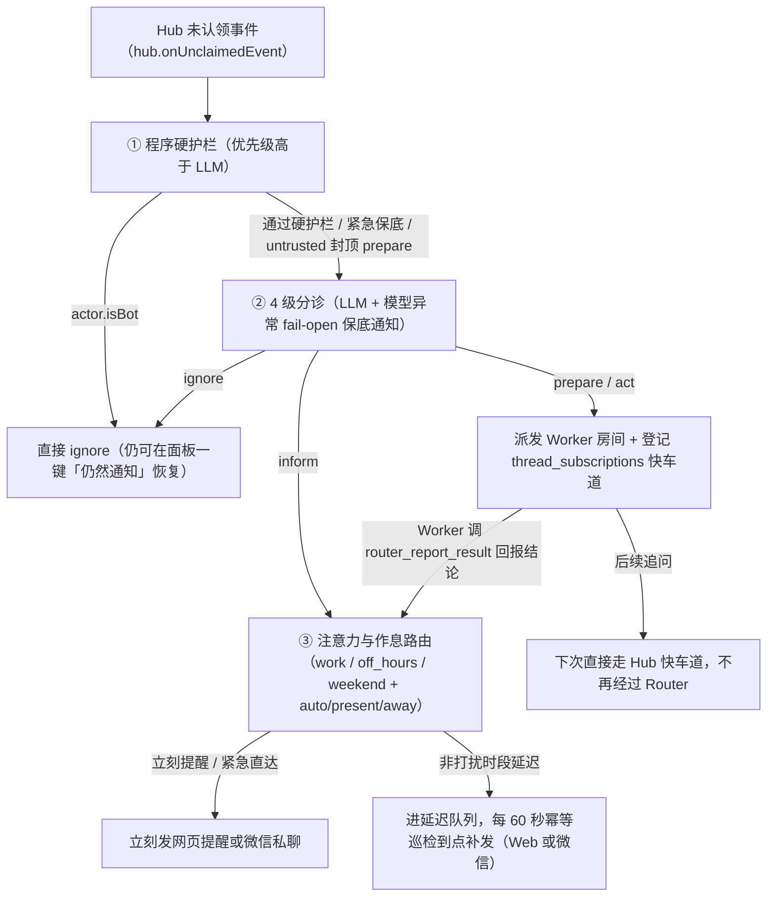
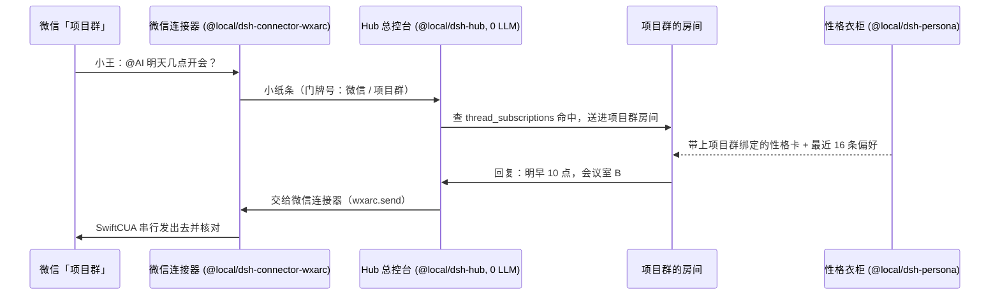
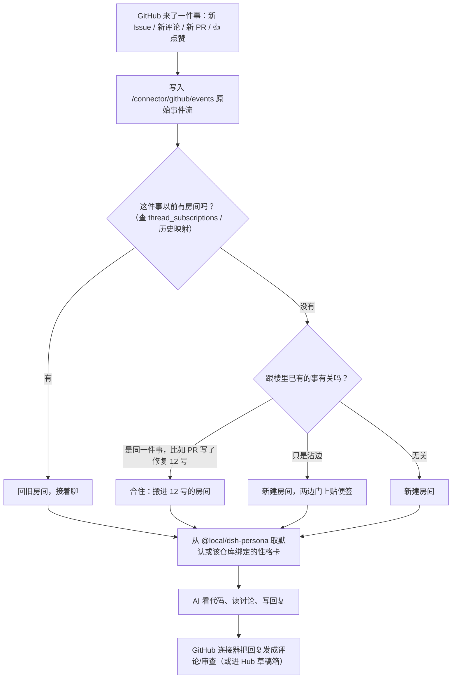
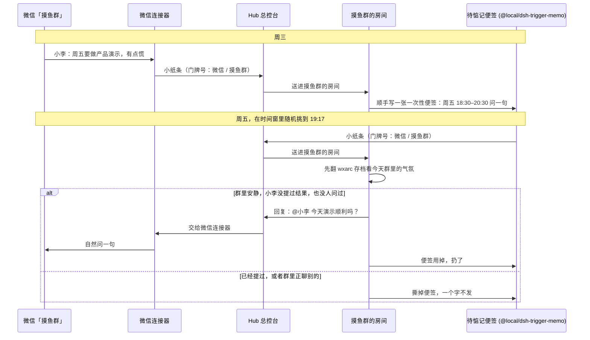
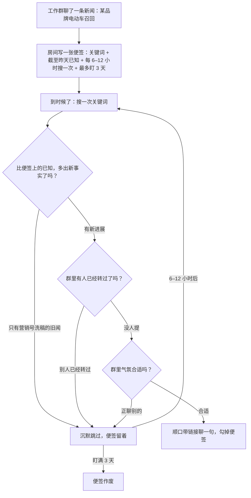
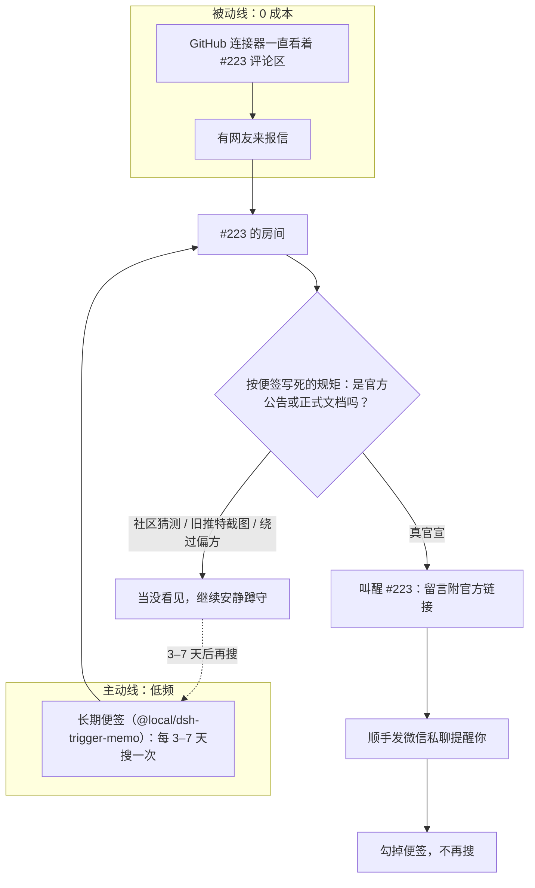
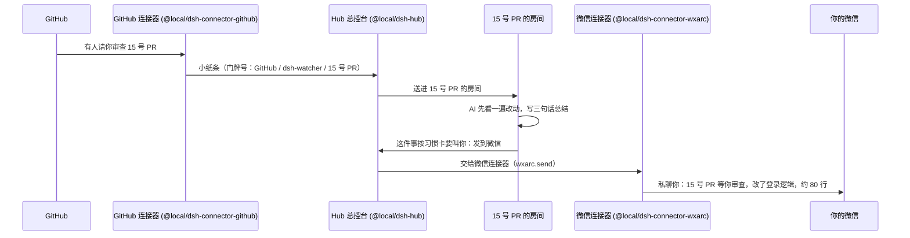

# 02 · 消息流转全过程

> **前提：本篇先假设一切安全、环境理想。** 不考虑有人捣乱，只看消息怎么走。
> 防捣乱的事放在 [04-以后再加的安全门禁](./04-以后再加的安全门禁.md)。

一共 4 条日常路线，其中路线 ③「主动开口」有 3 种便签：

| 路线 | 从哪来 | 到哪去 |
|---|---|---|
| ① 微信群来消息 | 微信连接器（`@local/dsh-connector-wxarc`） | 回微信 |
| ② GitHub 来事 | GitHub 连接器（`@local/dsh-connector-github`） | 回 GitHub |
| ③-1 短期待惦记：周五问演示 | 待惦记便签（`@local/dsh-trigger-memo`，一次性） | 看过气氛，合适才在微信问一句 |
| ③-2 热点查后续：昨天聊过的新闻 | 待惦记便签（最多盯 3 天） | 真有新进展，才在微信顺口带链接说一句 |
| ③-3 长期蹲官宣：Issue #223 | 待惦记便签（每 3–7 天）+ GitHub 评论区 | 真官宣时回 #223，再发微信提醒你 |
| ④ 跨通道叫你 | GitHub 连接器 | 经 Hub 总控台转微信连接器发微信 |

### 先看一眼 Hub 总控台的确定性分拣规则（0 次 LLM 调用）与 Router 冷启动接力

任何小纸条送到 `@local/dsh-hub` 后，Hub **从不调大模型**，只按 3 步确定性规则分拣：

1. **查 `thread_subscriptions` 快车道直达表（含 GitHub PR 自动继承 Issue 订阅）**：这条线索（比如某个微信群或 GitHub Issue/PR）已经绑定了活跃房间，Hub 直接把纸条送进去，毫秒级命中，**完全绕过 `@local/dsh-router`**，不花一次分诊推理。若收到的是 GitHub PR 事件且该 PR 尚未登记订阅，Hub 会自动读取 `payload.linkedIssues`（及兼容 `payload.linkedFromIssue`）中关联的同仓 Issue 号，查找对应活跃订阅并自动为该 PR 登记同会话快车道（复用 `sessionId`/`workstreamId`/`personaId`/`owner`，并在 `metadata` 中记录 `linkedFromThreadKey`）；对 `owner === 'router'` 且含 `metadata.decisionId` 的快车道，唤醒提示词还会自动透传 `summary`、`reviewState`、行内评论 `path`/`line`（空正文 Review 回退到 `summary`），并附上 `decisionId` 与分级回报指示——有新审阅意见/人类评论或新进展时调用 `router_report_result`（改界面附 `imagePath` 截图），若仅为 PR 合并、Issue 自动关闭等无新意见/无需处理的系统状态回声则直接静默结束，不调用 `router_report_result` 打扰管理员。
2. **冷启动未认领事件交给 `onUnclaimedEvent`（`@local/dsh-router`）**：快速表里没命中时，Hub 把纸条递给注册在 `onUnclaimedEvent` 上的 Layer-3 大脑 `@local/dsh-router` 做 4 级分诊、程序硬护栏校验、派发 Worker（并帮它登记 `thread_subscriptions`，让后续消息自动切回第 1 步快车道）或按你的作息发提醒。
3. **默认按门牌号落房**：若未安装 Router 或钩子选择放行，Hub 按门牌号找到对应房间（没有就新建），同一间房串行排队处理。

---

## 路线 ⓪：冷启动新事进 `@local/dsh-router`（分诊 → 派发 Worker / 作息提醒 → 切回快车道）

凡是 Hub 快车道里还没登记过的**新线索**，以及 Worker 干完活后用 `router_report_result` 工具交回来的**阶段结论**，都会经过 `@local/dsh-router`（「Router」，order 10）：

**4 条铁规矩：**

1. **4 级分诊 + 程序硬护栏高于大模型**：每件冷启动新事分为 `ignore`（忽略）、`inform`（只提醒）、`prepare`（派 Worker 准备方案/草稿，不直接外发）、`act`（派 Worker 直接执行）。分诊 LLM 调用默认使用 `maxTokens: 2400`，若首次未解析出合法分诊 JSON 会自动进行 1 次「仅返回严格 JSON」的简短重试；重试仍失败时通过 `logger.warn`（兜底 `console.warn`）输出受控长度（`≤ 200` 字符）诊断片段并进入 **fail-open** 兜底——对非关闭/未合并且非 bot 的 `github.issue.updated` / `github.pr.updated` 自动升级为 `prepare` 派发 Worker（关闭/合并态维持 `inform`）。代码写死的护栏永远盖过模型判断：`actor.isBot` 一律 `ignore`；标记紧急的事件**永不忽略**；`untrusted` 来源最高只能到 `prepare`。被标成 `ignore` 的条目也随时能在「Router → 分诊」里一键点 **「仍然通知」** 恢复。
2. **注意力与作息路由 + 微信降噪**：根据当前时段（`work` 工作日 / `off_hours` 下班后 / `weekend` 周末）与你的在席状态（`auto` 2 分钟网页活跃检测 / `present` 在电脑前 / `away` 离开）自动决定发网页提醒、转微信私聊还是延后；紧急事件走**紧急直达覆盖**不受作息拦截。微信目标 `wechatTarget` 保持默认 `filehelper`（或留空）时，Router 会自动向微信连接器查询并对齐管理员微信号 `controllerId`（若显式填了其他会话 ID 则尊重配置）。为了不轰炸微信，**普通非紧急 `inform` 一律留在网页提醒箱**（`inform_web_only`），`prepare`/`act` 刚派发 Worker 时也只记网页提醒（`worker_pending_report`），等 Worker 拿出结果再推微信。所有延迟通知由 60 秒定时器按幂等键补发到 Web 或微信；拿不准规则怎么生效时，直接在「注意力与作息」页用 **「情境预演」** 模拟任意时间与紧急程度。
3. **Worker 源头瘦身与截图回报 + 快车道闭环**：Router 派发 Worker 房间时会自动调用 `hub.registerSubscription` 登记快车道——此后同一条线索上的新评论或追问直接由 Hub 送进该房间，彻底绕过 Router。Worker 干活时不往业务仓库乱写临时分析 `.md`，查完或改完后调用 `router_report_result` 回报给 Router；`submitWorkerReport` 直接以 `conclusion` 作为摘要，**不再把 `changes` 拼进微信正文**，且在 Worker 派发提示词、工具 schema 与微信追问转发提示词中统一约束：
   - `conclusion`：严格 `≤ 200` 字的大白话，只讲结论、风险和需要管理员拍板的点，不背函数名、文件路径和代码流水账；
   - `imagePath`：本地绝对路径的运行截图（PNG/JPEG，≤ 8 MB），改界面时直接随微信消息发给你看；
   - `draftText`：像真人维护者一样 3–6 句话说完（一般 `≤ 500–600` 字符，不逐行复述作者代码或写带小标题的评审长文），且**仅用于微信审阅确认、绝不会自动发到 GitHub**（需管理员确认后再显式调用 GitHub 写入工具）；
   - `blindspot`：没实测到或不确定的边界，诚实摊开；
   - `mode`：交互模式（`discuss` 讨论 / `review_draft` 审草稿 / `done` 已完成）。
   每轮回报都会生成独立幂等后缀（`report:<时间戳>:<随机串>`），多轮修改反复汇报不会撞车，且每轮独立刷新 `question`、`options` 与 `recommendedIndex`（本轮未传或空白即清空，不再复用上一轮遗留确认题；选项本身已含 `（推荐）`/`(推荐)` 时不再重复拼接），并自动记录 7 天 / 30 天效果统计（已发提醒、已过滤噪音量、恢复率、活跃快车道数与推荐选项采纳率）。
4. **面板随时可控**：侧边栏 **「Router」** 提供 4 个标签页（**分诊** / **提醒队列** / **注意力与作息** / **效果与快车道**），支持直接查看分诊依据、一键恢复、手动派发 Worker、勾选推荐选项回复，以及查看全部活跃快车道订阅。

### 微信单焦点双向协作：一次只聊 1 个 Issue，直接回复就能让 Worker 接着改

推送到管理员微信的每条提醒开头都带短编号（例如 `[#42]`）：首条推送、`#编号` 切换、`下一个` 切换以及延迟队列弹出（`tickDeferred`）均发送含链接与末尾操作提示的完整版；同一焦点内的续发回报则自动走**紧凑格式**（省去重复链接与末尾固定提示语）。为了避免多个 Issue 在同一个微信私聊里串台，Router 采用**单焦点模式**：

- **一次只盯 1 件事（FIFO 排队 + `deferred` 去重覆写 + 失败保底）**：同一时间微信里只保持 **1 个活跃焦点**（持久化 `focused_decision_id`）。已有焦点时，其他非紧急汇报按 **FIFO（`created_at ASC, rowid ASC`）** 排在后面（`queued_behind_focus`），60 秒延迟巡检也不会插嘴；同一 `decisionId` 多次排队或微信暂不可用时，通过 `upsertDeferredWechatNotification` 原地覆写既有未送达 `deferred` 记录（保留最早 `createdAt` 维持 FIFO 顺位、刷新最新摘要与时间并收敛重复行），送达或手动切换焦点后同步清理残留 `deferred` 行；`tickDeferred` 调用微信投递失败时保持 `deferred` 并在 `reason` 追加 `wechat_delivery_failed`，绝不误标 `delivered` 或抢占焦点。超过 **24 小时**未交互则自动释放焦点，紧急事件仍可即时直达。
- **直接回话就能续聊 / 改代码**：你在微信私聊直接发消息（或引用某条带 `[#编号]` 的提醒回复），`@local/dsh-connector-wxarc` 识别为管理员 `controllerId` 私聊后，经纯确定性的 `hub.dispatchAdminWechatMessage(...)` 交给 `@local/dsh-router`，把你的原话原路送进对应 Worker 会话接着讨论或改代码；Worker 改完后再次调用 `router_report_result` 把新说明与新截图回你微信。
- **无焦点绝不误拦**：当前没有活跃焦点、且你发的不是指令或有效任务编号时，Router 返回 `{ handled: false }`，微信连接器照常放行你原本的聊天流程。

| 你在微信里发什么 | 系统怎么处理 |
|---|---|
| `列表` / `还有啥` / `在忙啥` / `任务` / `list` | 列出当前正在聊的焦点和后面排队的待办（带 `[#编号]`） |
| `下一个` / `跳过` / `完成` / `关闭` / `结束` / `next` / `skip` / `done` | 仅在有活跃焦点时生效：收起当前焦点，立刻切出排队里的下一条（连同文案和附图 `imagePath` 一起发给你） |
| `先放着` | 仅在有活跃焦点时生效：把当前焦点暂存回延迟队列，立刻切出下一条 |
| `#编号` 或 `#编号 你的想法` | 把焦点切到该编号任务；只发编号就重发它的最新进度与截图，带文字就直接转发给对应 Worker 接着处理 |
| 引用某条带 `[#编号]` 的消息直接回复 | 自动把焦点切到被引用的任务，并把你的回复连同引用上下文送给对应 Worker |
| 有焦点时直接发普通话 | 直接送进当前焦点的 Worker 会话继续聊/改代码 |

---

## 路线 ①：微信群来消息 → 回微信

**走一遍：**

1. 微信连接器 `@local/dsh-connector-wxarc` 每 3 秒看一眼有没有新消息，看到小王的话。
2. 写成小纸条，门牌号是「微信 / 项目群」，交给 Hub 总控台（或本机 wxarc 闭环直接接入同一个性格衣柜与便签工具）。
3. Hub 总控台查 `thread_subscriptions` 命中项目群房间，把纸条送进去。
4. AI 从独立的 `@local/dsh-persona`（「性格衣柜」）取「项目群」绑定的设定卡（含提炼风格 + 最近 16 条带原话依据的偏好；若是本人私聊还会按需做 `foundation` CJK 2-gram 检索），翻一下之前的聊天，写好回复。
5. 回复交回微信连接器，通过 SwiftCUA 串行队列发出去并核对结果。

同一个 AI，在「家人群」会带上另一张设定卡，说话就是另一种样子。想改语气时，在「微信消息」面板点「去性格衣柜编辑」即可一键跳到 **「性格衣柜」**。

---

## 路线 ②：GitHub 来事 → 回 GitHub

先决定**进哪间房**：

**举个例子：**

1. 有人开了 12 号 Issue：「登录页点了没反应」。GitHub 连接器把原始事件先放进 `/connector/github/events`（你在侧边栏 **「GitHub」** 面板能直接看到实时流水），发现没有旧房间，**新建一间**。AI 带上这个仓库在「GitHub」面板里绑定的性格卡（没单独绑就用默认 GitHub 性格卡），去仓库找登录页代码，回复「可能是按钮事件没绑上，在 `login.js` 第 40 行附近」。
2. 第二天，他在 12 号下面追问。这是旧事，Hub 查 `thread_subscriptions` 直接**回旧房间**。AI 记得昨天聊过什么，直接接着答。
3. 第三天，有人提了 15 号 PR，说明里写「修复 12 号」。这是同一件事，**合住**：AI 在同一间房里，既看得到 Issue 的讨论，也看得到 PR 改的代码，还会先用 `git merge-tree` 预检冲突。
4. 15 号 PR 评论里顺口提了 20 号 Issue。只是沾边，**贴便签**：两间房各住各的，AI 知道隔壁有相关的事，需要时去看一眼。

GitHub 连接器 `@local/dsh-connector-github` 的工作方式：默认每 1 分钟（重点盯防条目默认 30 秒）去 GitHub 问一次「有没有新动静」。监听仓库的 Issue / PR 在 SQLite `source_cursors` 中保存快照（标题、状态、草稿标记、标签、正文摘要与评论数）：
- **增量评论与 PR 审阅拉取**：当 `updated_at` 变化或评论数增加时，非盯防条目自动拉取 `/issues/{number}/comments` 产出 `github.issue.comment` / `github.pr.comment`，对 PR 还会同步拉取 `/pulls/{number}/reviews`（跳过 `PENDING` 与空正文 `COMMENTED`，保留 `APPROVED` / `CHANGES_REQUESTED` 与有正文的 `COMMENTED`）和 `/pulls/{number}/comments`（行内代码审阅评论，带 `[path:line]` 位置），并统一自动跳过自发/机器人评论；主楼事件（`github.*.updated` / `github.*.labeled`）仅在标题、状态、Draft、标签或正文实质变更且非自发/机器人时发出。
- **Bot / 自发 PR 不再吞掉人类评论**：即使 PR/Issue 是由 `[bot]` 或 GitHub App 机器人创建（主楼更新被跳过），连接器仍会维护快照并正常拉取其下的人类评论、PR Review 与行内审阅评论；开放中的 Bot/自发 PR 首次纳管时会直接全量补拉一次评论与审阅（不设 `baselineMs` 截断，由 `seen:*` 与 Hub `dedupeKey` 去重；若接口瞬态失败则回滚快照并在下轮自动重试）。
- **关联 Issue 号提取（`linkedIssues`）**：连接器通过 `extractLinkedIssues` 自动解析 PR 正文中的 `Fixes` / `Closes` / `Resolves #N`（含 `Fix`/`Fixed`/`Close`/`Closed`/`Resolve`/`Resolved` 及同仓 `owner/repo#N`，忽略 HTML 注释与跨仓引用），在 PR 主楼、普通评论、PR Review 与行内审阅评论的 `payload.linkedIssues` 中统一透传，供 Hub 自动继承原 Issue 的活跃 Worker 会话。
- **外发身份**：发评论或审查时，优先走原生 **GitHub App 机器人（`<slug>[bot]`）**（每小时自动换临时令牌，给你自己提的 PR 也能直接 `APPROVE` / `REQUEST_CHANGES`），未配置 App 时才回退静态 Bot Token 或个人 Token。

---

## 路线 ③：主动开口（不用等别人说话）

由独立触发器插件 `@local/dsh-trigger-memo` 负责。不定死「每天几点发一条」，而是像人一样：**听到一件事，顺手记一张便签；到时候先看一眼群里，合适才开口，不合适就撕掉。**

每张便签都写清 5 件事：

| 便签上写什么 | ③-1 周五问演示（`time_nudge`） | ③-2 新闻查后续（`news_followup`） | ③-3 蹲 #223 官宣（`long_watch`） |
|---|---|---|---|
| 惦记的事 | 小李周五的产品演示顺不顺利 | 「某品牌电动车召回」有没有新进展 | Gemini 官方哪天正式支持 ACP 或第三方 harness |
| 写便签的依据 | 周三小李在摸鱼群说「周五要做产品演示，有点慌」 | 工作群聊过这条新闻。截至昨天已知：召回 3 万辆，原因还在查 | Issue #223「Antigravity 订阅授权后 429」，社区绕过办法会被封号，决定等官方 |
| 时间窗或频率 | 周五 18:30–20:30，窗口里随机挑一刻，只问 1 次 | 每 6–12 小时搜一次关键词，最多盯 3 天 | 每 3–7 天搜一次，不设截止日 |
| 什么才算真动静 | 到点时群里安静，小李没说过结果，也没人问过 | 比「已知」多出新事实：官方新回应、新数字、新结论 | 只认官方公告、正式文档、新版本发布 |
| 作废条件 | 小李自己说了结果 / 有人先问了 / 群里正聊别的 / 错过时间窗 | 盯满 3 天 / 群里有人已经转了后续 / 已经说过一次 | 官方发布、提醒完你就勾掉；或你自己关掉 #223 |

### ③-1 短期待惦记：周五问演示

**规矩：**

1. **到点不卡整点。** 在 18:30–20:30 里随机挑一刻，这次是 19:17。
2. **开口前先看气氛。** 已经有人提过、或群里正聊别的，便签直接撕掉不发；安静才自然问一句。
3. **按自然日每房默认最多 1 次（默认 `proactiveBudgetMode: 'calendar_day'`，滚动模式默认 `18` 小时）。** 跨天同时间窗随机抽取不会撞车；若额度暂时用尽但当前时间窗还没结束，自动顺延到额度恢复时间再发，只有窗口内确实无法恢复时才撕掉。
4. **没人接不追问。** 问过一次就算用掉。
5. **错过窗口作废。** 电脑休眠、重启后也不补发。

### ③-2 热点查后续：昨天聊过的新闻

后续新闻**没有固定网址**可盯，所以便签记的是「关键词 + 截至昨天已知」，拿来和新搜到的对比。

**说出口的样子：** 「昨天聊的电动车召回有后续了：官方说原因查明了，免费换电池。链接放这：官方公告」。说过一次就勾掉，不再盯。

### ③-3 长期蹲官宣：Issue #223 等 Gemini 官方支持

#223 是「Antigravity 订阅授权后 429」。社区的绕过办法会被封号，所以 #223 一直开着，等 Gemini 官方正式支持 ACP 或第三方 harness。没人知道哪天上线，于是**两条线守在 #223 同一个房间**：

**关键点：**

1. **便签写死「只认官方」。** 只认官方公告、正式文档、新版本发布；社区猜测、旧推特截图、绕过偏方一律当没看见，#223 里不留言，也不发微信打扰你。
2. **被动线不多花钱。** 网友在 #223 下面报信，GitHub 连接器照常巡逻就能看到，房间再按同一条规矩核对。
3. **真官宣时两边都说。** 先在 #223 留言附官方链接，再按「主动发微信」私聊你：「你挂着的 #223 有动静了，官方支持 ACP 了，要不要看接入方案？」
4. **说完就勾掉。** 便签不再搜。

**三种便签和路线 ① 的唯一区别：** 门铃不是别人按的，是 `@local/dsh-trigger-memo` 按的。微信 `time_nudge` 便签到点后优先经 `wxarc` 的 `triggerMemoNudge` 回到原微信会话，由分身按性格卡自然组织提醒并通过 `mentions` 原生 `@` 群成员，同时在 Hub 收件箱记一条直达原微信会话的留痕（不再重复派发 Router Worker）；所有活跃便签都可以在侧边栏 **「Hub 总控台 → 便签本」** 一览、手动立即检查或撕掉。

> 双向微信连接器 `@local/dsh-connector-wxarc` 已经把「监听/回复」与「主动发（`wxarc.send` 出口、`wxarc_proactive_send` 工具、双模式桥接、`watcher_memo_*` 便签联动）」合在一个插件里，见 [03-怎么拆分与落地步骤](./03-怎么拆分与落地步骤.md) 与 [05-消息怎么真正发出去](./05-消息怎么真正发出去.md)。

---

## 路线 ④：GitHub 来急事 → 发微信叫你

**关键点：**

1. 「什么事算急事」写在仓库绑定的性格/习惯卡里（在「性格衣柜」维护、在「GitHub」面板绑定），比如：有人请你审查、Issue 标了紧急、自动测试挂了。
2. 「发给谁」也写死在规则里（你本人的微信），AI 只负责写内容，不负责挑收件人。
3. GitHub 和微信两个连接器互相不认识，全靠纯确定性的 `@local/dsh-hub` 总控台传话（由 `@local/dsh-connector-wxarc` 注册的 `githubToWechatRule` 路由规则接力到 `wxarc.send` 出口）。路线 ③-3 里 #223 官宣后发微信提醒你，走的也是这条路。

---

## 现实中的 6 个小状况

| 状况 | 怎么办 |
|---|---|
| AI 正在干活，同一间房又来一条消息 | **先排队，不打断。** 干完再看排队的。同一个人连发好几条，合起来一次看。不同房间互不影响，可以同时干。 |
| 电脑休眠，醒来时攒了一堆消息 | **醒来补查一次，合并成一张纸条。** 不会一口气回 20 条。太旧的（比如超过 5 分钟）只记下来，不回复。 |
| 自己回复完，会不会又触发自己 | **自己发的消息做个小记号，看到记号就跳过。** `@local/dsh-connector-wxarc` 会跳过小号本人消息，`@local/dsh-connector-github` 会跳过带隐形记号及 `[bot]`（含 GitHub App 机器人）自己发出的评论。 |
| 同一件事收到两次（比如 GitHub 重复通知） | **每张纸条有编号，见过的编号直接扔掉。** |
| 发出去失败，或者不确定发没发出去 | **标成「待核实」，不自动重发。** 等你在「Hub 总控台 → 草稿箱」看一眼再决定。`@local/dsh-connector-wxarc` 与 `@local/dsh-hub` 都是这么做的。 |
| 便签到时候了，但群里不合适、额度未恢复或已经错过 | **气氛不合适或错过窗口则撕掉/作废，不补发；若仅因主动额度暂时用尽且仍在时间窗内，顺延到额度恢复后发出。** 按自然日每房默认最多主动开口 1 次（滚动模式默认 18 小时），没人接不追问。 |

---

**下一篇：** [03-怎么拆分与落地步骤](./03-怎么拆分与落地步骤.md)：6 个运行时插件 + 1 个聚合包的真实目录结构、无损迁移与部署方式。
