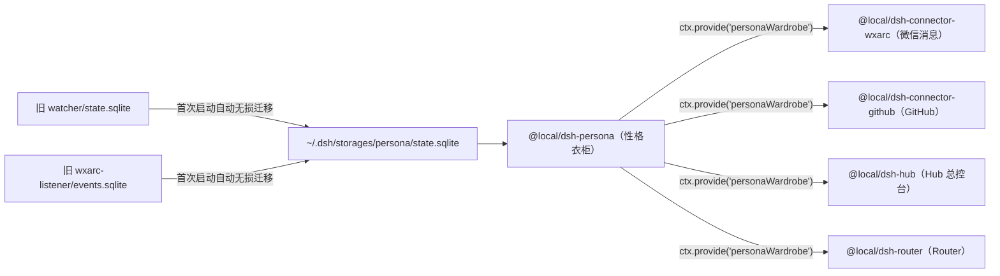
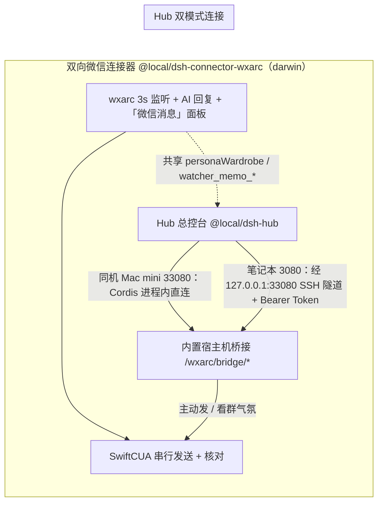

# 03 · 怎么拆分与落地步骤

> **一句话：** 整套能力彻底拆成 **6 个运行时插件 + 1 个聚合包**：独立性格衣柜（`@local/dsh-persona`）+ 纯确定性 Hub 总控台（`@local/dsh-hub`，0 LLM）+ Layer-3 Super-agent 智能大脑（`@local/dsh-router`，侧边栏「Router」）+ 独立 GitHub 连接器（`@local/dsh-connector-github`，含独立侧边栏面板）+ 双向微信连接器（`@local/dsh-connector-wxarc`，仅 macOS）+ 主动待惦记便签（`@local/dsh-trigger-memo`）+ 一键汇总包（`@local/dsh-hub-bundle`）。

---

## 一、为什么这样分：6 个插件各管一摊

### 1. `@local/dsh-persona`（独立「性格衣柜」，`id: persona`）

性格设定和学习记忆是长期资产，不应该绑死在微信里，也不该混在总控台数据库里。现在它独立成侧边栏 **「性格衣柜」**，暴露 `/local-persona/*` 路由和 `ctx.provide('personaWardrobe')` 服务：



完整保留原 wxarc 全部 **3 项学习能力** + 试聊：

1. **本人历史发言风格提炼**：喂一批你本人发过的旧消息（`/local-persona/personas/:id/learn-style`），提炼句长、措辞、语气；之后每次进门只带提炼结果，不塞原文。
2. **带原话依据的 24 / 16 聊天偏好记忆**：按「性格 + 房间（`scope`）」分开记对方明说的偏好与原话依据，最多留 **24 条**，每次进门带最近 **16 条**；支持在「性格衣柜」里手改、删除与清空；朋友圈（`sns:*`）与试聊（`/local-persona/personas/:id/preview`）绝不自动写入记忆本。
3. **本人私用 `foundation` CJK 2-gram 检索**：支持把个人背景资料导入性格资产库（`/local-persona/personas/import-foundation`），用纯 TypeScript 实现的 CJK 2-gram 相关性检索召回；**仅限本人私用上下文**，绝不向群友或外部公开仓库泄露。
4. **单一编辑入口 + 多连接器圈层与只读 Vault 挂接**：人物的新增、设定修改、风格学习、24/16 记忆管理、`foundation` 导入与试聊全部收口在侧边栏 **「性格衣柜」**；「微信消息」面板与「GitHub」面板只放精简版下拉选择器 + **一键跳转「性格衣柜」** 按钮。`chat_circle` 圈层表兼容裸微信 `chatId` 与多连接器前缀（`wxarc:<id>`、`dingtalk:<cid>`、`github:<owner/repo>`，其中 `wxarc:` 与裸 ID 双向回退、直接命中优先），并暴露 `resolveChatCircle`、`resolveVaultVisibility`（未打标一律返回 `'owner_private'`，`foundation` 恒为 `'owner_private'`）、`searchVaultKnowledge`（`snippet ≤ 220` 字）与 `getVaultKnowledgeContext`（不跨圈层带出邻居）供 Hub 自动挂接 `VaultProvider('persona')`。

### 2. `@local/dsh-hub`（纯确定性「Hub 总控台」，`id: hub`）

- **100% 纯确定性事件总线（0 次 LLM 调用、0 新数据库表）**：Hub 本身永远不调大模型，只管统一收件箱、便签本、`DoorGuard` 草稿箱门禁、已接入插件总览与房间排队，同时提供 `ctx.provide('vault', service.vault)` 与全局只读工具 `vault_search`（默认 10 / 上限 20，`snippet ≤ 220` 字）/`vault_context`（默认 5 / 上限 15），并在 `personaWardrobe.searchVaultKnowledge` 可用时自动桥接 `VaultProvider('persona')`。
- **内存 `SessionPrincipal`、粘性污点锁与跨连接器底座**：维护纯内存 `sessionPrincipals`、`taintedSessions`、`sessionTurnOverrides`、`turnPrivateRead`、`targetDirectories`（`TargetDirectoryProvider`：`registerTargetDirectory`/`resolveTarget`/`listTargets`）与 `threadLifecycleHandlers`（`onThreadLifecycle`）；`resolveSessionPrincipal(exec)` 执行无 `agent.id` Fail-Closed（`tier: 0`）、子代理向上追溯不提权与污点向上传染，非 `external` 命中即打粘性污点并由 `DoorGuard` 在 `invokeSink` 中强制 `stageOnly: true` 退回草稿箱且对公网目标附带 `PUBLIC_TAINT_WARNING_TEXT`。
- **两级路由 + 快车道（含 PR 自动继承 Issue 订阅）+ 终态销账 + 管理员微信分发总线**：`ingest()` 先检测终态事件（`.closed`/`.merged`/`payload.state === 'closed'`/`payload.merged === true`/`payload.lifecycleOnly === true`）并派发 `onThreadLifecycle`（`lifecycleOnly: true` 仅销账返回 `routedVia: 'lifecycle'`，不唤醒 Worker）；再查 `thread_subscriptions` 快车道直达（PR 自动继承同仓 `linkedIssues` 活跃订阅，绕过 Router）；未认领冷启动事件走 `onUnclaimedEvent` 交给 `@local/dsh-router`；并提供 `registerAdminWechatHandler` / `dispatchAdminWechatMessage`（向下兼容多模态字段 `sourceKey`/`localType`/`imagePath`/`voiceTranscript`/`articleSummary`/`mediaPaths`）解耦转发单一主人微信私聊。
- **4 标签页平台无关 UI 与无损兼容**：侧边栏 **「Hub 总控台」** 包含 **「收件箱」**、**「便签本」**、**「草稿箱」**、**「已接入插件」** 4 个标签页；同时挂载 `/local-hub/*` 与 `/local-watcher/*` 双前缀路由，自动原地复用旧库 `~/.dsh/storages/watcher/state.sqlite`。

### 3. `@local/dsh-router`（Layer-3 Super-agent 智能大脑，`id: router`，侧边栏「Router」，order `10`）

架在 `@local/dsh-hub` 之上的独立智能大脑，状态独立存放在 `~/.dsh/storages/router/state.sqlite`（WAL + `STRICT` 表 + `0600` 权限）：

- **只接冷启动 + 终态销账 + Worker 回报**：订阅 `hub.onUnclaimedEvent(...)`、`hub.onThreadLifecycle(...)`（PR/Issue 关闭或合并时自动将未决 `router_decisions` 置 `resolved`、`deferred` 通知置 `read` 并清 `sessionTurnOverride`）与绑定 `boundDecisionId` 顶层 Worker 的 `router_report_result` 回报；已登记快车道的旧线索直接走 Hub 快车道。
- **4 级分诊 + 程序硬护栏 + Worker 四档沙箱**：按 `ignore`/`inform`/`prepare`/`act` 分诊，硬护栏优先于 LLM（`actor.isBot -> ignore`、紧急永不忽略、`untrusted` 封顶 `prepare`、异常 fail-open + 一键「仍然通知」恢复）；Worker 派发与启动预热按四档注册（公开陌生人 1 / 工作私有源 2 / 主人发起 3，兼容 `github:owner/repo#N` 解析 `boundRepo`）并挂原生无网沙箱（`prepare -> read-only` / `act -> workspace-write`）。
- **无焦点锁作息路由 + 积压 `≥ 3` 合并汇总卡**：彻底移除 24 小时焦点锁（无 `focused_decision_id`/`queued_behind_focus`）；60 秒幂等巡检 `tickDeferred()` 在积压 `≥ 3` 条时自动合并为 **1 张无锁摘要卡**并静默注入 `owner_session` 回执；通知底部统一为 `引用本条或回 #<shortId> 接着聊`，公网污点草稿顶部附 `PUBLIC_TAINT_WARNING_TEXT`；微信目标默认 `filehelper` 自动对齐 `controllerId`；内置 **「情境预演」**（`POST /local-router/preview`）。
- **薄 `owner_session` 桥接 + 0-LLM 顶层分拣 + 统一审批与 `tools/pre-execute` 护栏**：在 `~/.dsh/workspaces/router-owner` 持久化 `owner_session_id` 并启动预热，推送卡片静默 `agent.inject()` 写 1 行 `[已推送给主人] [#shortId] ...` 回执；注册顶层 `owner_session`/`interactive` 桥接工具 `router_tasks` / `router_send_to_task`；主人微信走 0-LLM 顶层分拣（确认词 → `列表` → `#编号`/引用直达 Worker 并支持单轮临时升权回落 → 1.5s 连发合并异步入 `owner_session`，回合结束按 `router-owner-reply:<turnId>` 回发并清 `turnPrivateRead`）；新增 `router_approvals`/`router_task_uses` 表并首次只读迁移旧 `wechat_approvals`（旧 `pending -> cancelled`），`tools/pre-execute` 硬拒污点 Worker（含子代理）的 `web_fetch`/`web_search`/`require_escalated`，并对 `owner_session` 非只读 `bash`、工作区外写/编、`wxarc_proactive_send` 与同轮 `isTurnPrivateRead + web_fetch` 100% 触发 8 位微信确认码。
- **实物/截图回报与 4 标签页 UI**：`router_report_result` 约束 `conclusion ≤ 200` 字、不拼 `changes`，支持 `imagePath`/`draftText`/`blindspot`/`mode`；暴露 `/local-router/*` 接口、7d/30d 统计与 4 标签页 UI（**分诊** / **提醒队列** / **注意力与作息** / **效果与快车道**）。

### 4. `@local/dsh-connector-github`（独立双向 GitHub 连接器，`id: connector-github`）

GitHub 拥有自己独立的侧边栏面板 **「GitHub」** 与 `/connector/github/*` 路由，并按标准三件套接入 Hub：

- **认证与无损凭证回退**：支持 Read Token 与原生 **GitHub App 机器人（`<slug>[bot]`）**（`node:crypto` RS256 JWT + 1 小时自动轮换安装令牌）；读取 `~/.dsh/.credentials.yaml` 时优先查 `connector-github/*`，自动回退旧 `watcher-github/*`（与 `gh-watch/*`）及本机 `gh auth token`。
- **性格卡绑定、3 标签页 UI 与 `lifecycleOnly` 终态补发**：在「GitHub」面板配置全局/单仓性格卡（一键跳转「性格衣柜」），提供 **「事件箱」** / **「仓库与盯防」** / **「账号与高级设置」** 3 标签页与持久化事件流；轮询在 `source_cursors` 持久化快照，Bot/自发 PR 仍持续拉取人类普通评论、PR Review 与行内审阅评论，并在 `open -> closed` 且跳过主楼更新时补发 `payload.lifecycleOnly = true` 终态事件触发 Hub `onThreadLifecycle` 自动销账；同时透传同仓 `linkedIssues` 并保留 `git merge-tree` 冲突预检。
- **只读 `VaultProvider('github')` 与外发主体/污点门禁**：向 Hub 注册 `VaultProvider('github')` 检索仓库快照与近期 GitHub 事件（优先采用 `personaWardrobe` 对 `github:<repo>` 的显式标注，未标注时公开仓 `'external'`、私有/未知仓 `'work'`）；`gh_stage_reply`/`gh_stage_review` 接入 `hub.resolveSessionPrincipal(exec)`（拒外部会话/子代理/跨仓 Worker）与 `DoorGuard` 粘性污点强退草稿箱 + 公网警告。

### 5. `@local/dsh-connector-wxarc`（双向 macOS 微信连接器，`id: connector-wxarc`，仅 `darwin`）

把微信监听、AI 回复、SwiftCUA 发送、Web UI **「微信消息」** 面板与 Hub 桥接合一放进单个 `darwin`-only 连接器，并完成瘦身与统一鉴权收敛：

1. **瘦身：单一主人 `controllerId` 收敛、退役 `wxarc_admin_sessions` 与主人多模态异步旁路**：
   - `resolveOwnerId(policy)` 将 `adminIds[]` 收敛为单一主人 `controllerId`（`validatePolicy` 禁止多管理员，仅 `controllerId` 为空时兼容回退 `adminIds[0]`；Web UI 收敛为单一主人输入框）。
   - 当 Hub 挂载 `adminWechatHandler`（Router 接管主人私聊）时，不再为 `controllerId` 创建或提权 `wxarc_admin_sessions`（启动时将遗留 `wxarc_admin_sessions` 降权为 `workspace-write` 并保留 `~/DSH-WeChat/<hash>` 磁盘目录只读不删），本地 `WechatApprovals` 也不再抢先消费 `controllerId` 确认词。
   - `Automation.collect()` 对 `controllerId` 纯文本/引用直达 `hub.dispatchAdminWechatMessage`；对图片（`3`）、语音（`34`）、短视频（`43`）、公众号文章（`49` 非引用）立即推进 `cursor` 落库并启动旁路异步预处理提取 `imagePath`/`voiceTranscript`/`articleSummary`/`mediaPaths` 后透传 Hub，绝不阻塞 3 秒主循环。
   - 非管理员 `dsh_conversations` 会话全部注册为 Hub 内存 `SessionPrincipal`（`role: 'external_chat', tier: 0, trustLevel: 'untrusted', boundRoomKey: chatId`）。
2. **标准三件套挂接、统一 Hub 鉴权与零硬编码局域网 IP**：
   - 向 Hub 注册只读 `VaultProvider('wechat')`（`events.sqlite`，`snippet ≤ 200` 字）与 `VaultProvider('nas')`（`searchNasArchive` + `getNasArchiveContext`），未标注一律归 `'owner_private'`；注册 `TargetDirectoryProvider`（保留 `wxarcTargetDirectory` 兼容过渡）。
   - `wxarc_messages`/`wxarc_status`/`wxarc_targets`/`wxarc_nas_search` 统一通过 `hub.resolveSessionPrincipal(exec)` 鉴权（要求顶层 `tier === 3 && delegationDepth === 0 && !isSubagent`）；`wxarc_proactive_send` 接入主体鉴权与 `DoorGuard` 污点校验（污点或跨群/群聊强制 `stageOnly: true` 进草稿箱）。
   - `nasArchiveUrl` 彻底移除硬编码局域网默认 IP（`DEFAULT_NAS_ARCHIVE_URL = ''`，仅从配置读取），并继续在 `transport.ts` 与 `nas-search.ts` 双重硬拦截端口 `8765`。
3. **完整保留群聊闭环与双模式桥接**：保持 3 秒轮询、每轮动态拉取「性格衣柜」设定卡与两步认图召回、`MediaPreprocessor` 语音/视频预处理、35 秒收图缩略图宽限等待、SwiftCUA 串行发送与核对、`/wxarc/*` 与 `/wxarc/bridge/*` 路由、双模式 `WechatTransport`（同机 Cordis / SSH 隧道，双模式均透出 `controllerId` 与 `imagePath`）、6 个 `.py`/`.jxa` 脚本及 `stateDir: ~/.dsh/wxarc-listener`。



| 场景 | 管子怎么连 | 安全红线 |
|---|---|---|
| **Mac mini 本机（端口 `33080`）** | Hub 与 `@local/dsh-connector-wxarc` 在同一个 DSH 进程里，直接走 Cordis 内存服务（`mode: 'cordis'`） | 只操作小号 `ownId` |
| **笔记本（端口 `3080`）** | 走现有的 `127.0.0.1:33080` SSH 隧道调 `/wxarc/bridge/*`（`mode: 'http'`，带 Bearer Token） | **硬拦截**本机个人微信 `127.0.0.1:8765` 与个人微信号 `ownId`，非回环地址默认拒绝 |

### 6. `@local/dsh-trigger-memo`（3 模式主动待惦记便签，`id: trigger-memo`）

负责 `time_nudge`（时间窗提醒；微信便签到点优先经 `triggerMemoNudge` 回流到对应的原微信 DSH 会话，主动消息额度默认按自然日 `calendar_day` 计数、滚动模式默认 `18` 小时）、`news_followup`（新闻增量追踪 3 天）、`long_watch`（长期蹲守如 #223，只认官方公告）三种主动便签调度。工具层 `watcher_memo_add` / `watcher_memo_list` / `watcher_memo_cancel` 优先接入 `hub.resolveSessionPrincipal(exec)` 与 `hub.resolveTarget(...)`（彻底移除 `currentRoomKey === null` 后门，严格按角色/档位落锁：子代理与 `unknown` 拒绝、`external_chat` 锁死本房、非 `untrusted` Worker 仅本房 `boundThreadKey` 且 `notifyWechatChatId` 仅限主人 `controllerId`、`untrusted` Worker 拒写/删、仅顶层 `tier === 3` 允许跨房操作），并向 Hub 注册只读 `VaultProvider('memo')`（`snippet ≤ 220` 字，未标注/`session:` 默认 `'owner_private'`）。

### 两张常见性格卡对比（均在「性格衣柜」统一维护）

| | 微信「家人群」性格卡 | GitHub「自研仓库」习惯卡 |
|---|---|---|
| 身份 | 小岚，家里的贴心助手 | 代码审查员 / 分诊助手 |
| 说话方式 | 口语、短句、偶尔带表情 | 先说结论，再列问题，附文件和行号 |
| 能做的事 | 聊天、记待惦记便签、到时候问一句 | 看代码、写评论、总结 PR |
| 重点关注 | 别太啰嗦，别聊工作 | 测试有没有跟上、与主分支有没有冲突 |
| 什么时候叫你 | 不叫 | 有人请你审查、#223 官宣了、出现急事 |

---

## 二、真实目录结构（6 个运行时插件 + 1 个聚合包）

整个仓库是 100% 严格模式 TypeScript（`.ts`）ESM Monorepo，只使用 Node 24 内置模块（含 `node:sqlite` 与 `node:crypto`），零第三方运行时依赖，且所有 `.ts` 文件保持零注释：

```text
dsh-watcher/
├── docs/                                唯一权威文档（01–05）
├── scripts/
│   ├── check-no-comments.ts             AST 级零注释检查脚本（不误报模板字符串里的 https://）
│   └── deploy-macmini.ts                基于 .env.deploy 的一键验证、打包、上传与重启脚本（零硬编码主机）
└── packages/
    ├── dsh-persona/                     @local/dsh-persona（Cordis ID: persona，侧边栏「性格衣柜」）
    │   └── src/
    │       ├── contracts.ts             PersonaWardrobe 与 Vault 知识检索共享契约类型
    │       ├── db.ts                    独立 SQLite 状态库（~/.dsh/storages/persona/state.sqlite）+ 首次启动无损自动迁移
    │       ├── wardrobe.ts / foundation.ts / multimodal.ts / wardrobe-policy.ts / wardrobe-recall.ts / wardrobe-import.ts / wardrobe-multimodal.ts
    │       │                            风格提炼、24/16 偏好学习、foundation 2-gram 检索、多连接器 chat_circle 圈层与两步认图召回
    │       ├── wardrobe-vault.ts        只读 Vault 知识检索与跨圈层隔离上下文展开（foundation 固定 owner_private）
    │       ├── http-routes.ts / http-routes-ext.ts  /local-persona/* 本地管理接口
    │       ├── client.ts                经典 IIFE 前端入口（注册侧边栏「性格衣柜」面板）
    │       └── index.ts                 Cordis 插件入口（ctx.provide('personaWardrobe')）
    ├── dsh-hub/                         @local/dsh-hub（Cordis ID: hub，侧边栏「Hub 总控台」，0 LLM 调用）
    │   └── src/
    │       ├── contracts.ts             WatchSource / ActionSink / VaultProvider / SessionPrincipal / TargetDirectoryProvider / ThreadLifecycleEvent 契约
    │       ├── db.ts / schema.sql       SQLite 状态库（16 张 STRICT 表，0 新增表，自动复用旧 watcher/state.sqlite）
    │       ├── guard.ts                 门口小保安 DoorGuard（beforeEnterRoom/beforeSendOut + 粘性污点强退草稿箱 + PUBLIC_TAINT_WARNING_TEXT）
    │       ├── vault.ts                 VaultRuntime（ctx.provide('vault')、四档双重过滤、vault_search/vault_context、自动桥接 persona）
    │       ├── session-bridge.ts        DSH 房间创建、唤醒、人工接管与重启恢复
    │       ├── posterior.ts             路由规则、分诊提示词、/watch 命令与房间工具
    │       ├── service.ts               纯确定性事件总线（快车道、onThreadLifecycle 终态销账、onUnclaimedEvent、内存 Principal/污点锁、TargetDirectory、草稿箱）
    │       ├── http-routes.ts           /local-hub/* 与 /local-watcher/* 双前缀本地管理接口
    │       └── client.ts                经典 IIFE 前端入口（4 标签页：收件箱、便签本、草稿箱、已接入插件）
    ├── dsh-router/                      @local/dsh-router（Cordis ID: router，侧边栏「Router」，order 10）
    │   └── src/
    │       ├── contracts.ts             4 级分诊、注意力策略、Worker 回报与统计契约
    │       ├── db.ts                    独立 SQLite 状态库（~/.dsh/storages/router/state.sqlite，含 router_approvals / router_task_uses + 7d/30d 统计）
    │       ├── policy.ts                作息与在席策略引擎（work/off_hours/weekend、auto/present/away、紧急直达与情境预演）
    │       ├── triage.ts                4 级分诊（ignore/inform/prepare/act）+ 程序硬护栏优先 + 模型异常 fail-open
    │       ├── owner-session.ts         薄 owner_session 桥接（~/.dsh/workspaces/router-owner、静默 1 行回执、router_tasks / router_send_to_task）
    │       ├── approvals.ts / task-permissions.ts  统一 RouterApprovals（首次只读迁移旧 wechat_approvals）与 tools/pre-execute 护栏
    │       ├── worker-dispatcher.ts     Worker 房间派发、四档 Principal 注册与预热、无网沙箱、快车道登记与 router_report_result
    │       ├── service.ts               订阅 onUnclaimedEvent 与 onThreadLifecycle（终态销账），0-LLM 顶层分拣、无焦点锁、积压 ≥3 合并汇总卡、60s 巡检
    │       ├── http-routes.ts           /local-router/* 本地管理接口
    │       ├── client.ts                经典 IIFE 前端入口（注册侧边栏「Router」order 10，4 标签页）
    │       └── index.ts                 Cordis 插件入口（inject: ['hub']，60 秒延迟投递定时巡检）
    ├── dsh-connector-github/            @local/dsh-connector-github（Cordis ID: connector-github，侧边栏「GitHub」）
    │   └── src/
    │       ├── auth.ts                  原生 GitHub App 机器人（RS256 JWT + 1h 安装令牌）、connector-github/* 回退与 gh CLI 兜底
    │       ├── poller.ts                轮询、Issue/PR 快照、linkedIssues、Bot/自发 PR 关闭补发 lifecycleOnly 终态事件与热更新
    │       ├── vault-provider.ts        只读 VaultProvider('github')（快照 + 近期事件检索与线程上下文展开）
    │       ├── graph-resolver.ts        Issue/PR 合住与便签图谱 + git merge-tree 冲突预检
    │       ├── sink.ts                  Hub 主体鉴权 + DoorGuard 粘性污点退草稿箱 + 公网警告 + autoSendOwners/单仓 autoSend + gh_stage_reply/review
    │       ├── http-routes.ts           /connector/github/* 本地管理接口
    │       └── client.ts                经典 IIFE 前端入口（独立侧边栏「GitHub」面板）
    ├── dsh-connector-wxarc/             @local/dsh-connector-wxarc（Cordis ID: connector-wxarc，侧边栏「微信消息」，仅 darwin）
    │   └── src/
    │       ├── index.ts                 入口、/wxarc/* 与 /wxarc/bridge/* 路由、VaultProvider('wechat'/'nas') 与 TargetDirectoryProvider 注册、统一 Hub 鉴权工具
    │       ├── admin.ts / automation.ts / agent.ts  单主人 controllerId 收敛、退役 wxarc_admin_sessions、主人多模态旁路异步预处理、外部会话 tier 0 注册
    │       ├── vault-provider.ts        只读 VaultProvider('wechat' / 'nas')（未标注一律归 owner_private）
    │       ├── targets.ts               群聊/私聊唯一花名册解析（注册为 Hub TargetDirectoryProvider）
    │       ├── nas-search.ts            NAS 微信档案只读检索与上下文展开（无硬编码默认局域网 IP、封禁 8765）
    │       ├── media.ts / outgoing-image.ts  语音/视频预处理、四信号防尴尬多模态提示词与本地 PNG/JPEG 截图安全校验
    │       ├── cua.ts / sender.ts       SwiftCUA 串行辅助功能发送、表情/图片处理与发送核对
    │       ├── host-side-bridge.ts / transport.ts / send-sink.ts  双模式桥接（Cordis/HTTP，透出 controllerId 与 imagePath）、wxarc.send、wxarc_proactive_send（Hub 鉴权 + 污点草稿箱）
    │       ├── client.ts                经典 IIFE 前端入口（单主人输入框 + 精简人物选择器 + 一键跳转「性格衣柜」）
    │       └── *.py / *.jxa（共 6 个）   辅助脚本（article-parser.py、clipboard.jxa、contacts.py、desktop-layout.jxa、image-pixels.py、mention-source.py）
    ├── dsh-trigger-memo/                @local/dsh-trigger-memo（Cordis ID: trigger-memo）
    │   └── src/
    │       ├── store.ts                 便签表、已看链接去重、自然日 / 18h 滚动主动开口预算与恢复时间计算
    │       ├── web-scout.ts             新闻增量过滤与长期官宣白名单核查
    │       ├── scheduler.ts             time_nudge / news_followup / long_watch 调度器
    │       ├── vault-provider.ts        只读 VaultProvider('memo')（活跃与近期便签检索与同房上下文）
    │       └── tools.ts                 房间工具 watcher_memo_add/list/cancel（接入 Hub SessionPrincipal 与 TargetDirectory）
    └── dsh-hub-bundle/                  @local/dsh-hub-bundle（一键聚合包）
        ├── cordis.patch.yml             DSH 启动清单（按 persona → hub → router → connector-github / trigger-memo / connector-wxarc 顺序加载）
        └── test/e2e.test.ts             跨 7 包端到端集成测试（覆盖真实主链路、Vault 四档隔离、污点锁、终态销账与无焦点锁协作）
```

---

## 三、落地状态与常用命令

目前 **6 个运行时插件 + 1 个聚合包** 已经全部落盘并通过各包单元测试与跨包端到端测试：

1. **独立性格衣柜（`@local/dsh-persona`）**：独立库 `~/.dsh/storages/persona/state.sqlite` 首次启动自动无损导入旧库数据；侧边栏 **「性格衣柜」** 承载风格提炼、24/16 偏好记忆、本人私用 `foundation` CJK 2-gram 检索与试聊；多连接器 `chat_circle` 圈层表兼容裸微信 ID 与 `wxarc:`/`dingtalk:`/`github:` 前缀，并通过 `resolveVaultVisibility` / `searchVaultKnowledge` / `getVaultKnowledgeContext` 供 Hub 自动桥接 `VaultProvider('persona')`。
2. **纯确定性 Hub 总控台（`@local/dsh-hub`）**：0 LLM 调用、0 新增表；通过 `ctx.provide('vault')` 挂载全局只读工具 `vault_search`/`vault_context`，结合纯内存 `SessionPrincipal` 执行四档双重可见性过滤与粘性污点锁（`DoorGuard` 强制 `stageOnly: true` + 公网警告）；提供 `TargetDirectoryProvider`、`onThreadLifecycle`（支持 `lifecycleOnly` 纯销账）、`thread_subscriptions` 快车道、`onUnclaimedEvent` 与 `dispatchAdminWechatMessage`；双路由 `/local-hub/*` + `/local-watcher/*` 并自动复用旧 `watcher/state.sqlite`。
3. **Layer-3 Super-agent 智能大脑（`@local/dsh-router`）**：独立库 `~/.dsh/storages/router/state.sqlite`；彻底移除 24 小时焦点锁，订阅 `onThreadLifecycle` 自动销账已合并/关闭的 PR 与 Issue；60 秒 `tickDeferred()` 积压 `≥ 3` 条合并为 1 张无锁摘要卡；在 `~/.dsh/workspaces/router-owner` 维护薄 `owner_session`（推送卡片静默注入 1 行回执，暴露 `router_tasks`/`router_send_to_task`），对主人微信走 0-LLM 顶层分拣（确认词 → `列表` → `#编号`/引用直达 Worker 并支持单轮升权回落 → 1.5s 连发合并入 `owner_session`）；统一承接 `RouterApprovals`（首次只读迁移旧 `wechat_approvals`）与 `tools/pre-execute` 护栏，Worker 按四档注册并挂接原生无网沙箱。
4. **独立 GitHub 双向连接器（`@local/dsh-connector-github`）**：按标准三件套接入 Hub（含只读 `VaultProvider('github')`），侧边栏独立 **「GitHub」** 面板管理 Read Token 与原生 GitHub App、性格卡绑定、监听仓库与原始事件流；对自发/Bot PR 关闭/合并补发 `payload.lifecycleOnly = true` 终态事件确保自动销账；`gh_stage_reply`/`gh_stage_review` 接入 Hub 主体鉴权与 `DoorGuard` 粘性污点强退草稿箱 + 公网警告。
5. **双向微信连接器 + 主动待惦记便签（`@local/dsh-connector-wxarc` + `@local/dsh-trigger-memo`）**：`@local/dsh-connector-wxarc` 完成瘦身（单一主人 `controllerId` 收敛、退役 `wxarc_admin_sessions` 与审批让渡 Router、主人多模态旁路异步预处理不阻塞 3s 轮询、非管理员会话注册 `tier: 0`、注册 `VaultProvider('wechat'/'nas')` 与 `TargetDirectoryProvider`、`wxarc_messages`/`wxarc_status`/`wxarc_targets`/`wxarc_nas_search`/`wxarc_proactive_send` 统一走 Hub 鉴权与污点草稿箱、`nasArchiveUrl` 零硬编码局域网默认 IP、继续硬拦截 `8765`）；`@local/dsh-trigger-memo` 注册 `VaultProvider('memo')` 并接入 Hub 主体与花名册鉴权（移除 `currentRoomKey === null` 后门）。

在 `dsh-watcher/` 根目录执行：

```bash
pnpm install
pnpm run build
pnpm test
pnpm run check:comments
```

### DSH `0.2.2-rc.1` 宿主机部署适配要点（Mac mini 已验证）

1. **启动顺序与 Cordis `4.1.0` 可选服务访问**：`dsh-hub-bundle/cordis.patch.yml` 按 `persona → hub → router → connector-github / trigger-memo / connector-wxarc` 顺序加载，保证 `personaWardrobe`、`hub`、`vault` 与 `router` 就绪后再挂载连接器与触发器。各包均通过 `ctx.inject(['webServer'], ...)` 按需挂载路由（`/local-persona`、`/local-hub` + `/local-watcher`、`/local-router`、`/connector/github`、`/wxarc` + `/wxarc/bridge`），其余可选服务通过 `ctx.get(...)` 读取，避免未注入属性触发 Cordis 代理报错。
2. **凭证存储（`$DSH_HOME/.credentials.yaml`，`0600`）**：`@deepseek-ai/dsh-credentials-local` `0.2.2-rc.1` 使用 `readRecord("<scope>/<id>")` 与 `resolve("<POSIX_REF>")`。`connector-github` 优先读 `connector-github/*`（如 `connector-github/github-app`、`connector-github/github-read`），未找到时自动回退旧 `watcher-github/*` 与 `gh-watch/*` 记录以及本机 `gh auth token`，平滑升级无需重填凭证。
3. **打包与热更新**：**6 个运行时插件**（`@local/dsh-persona`、`@local/dsh-hub`、`@local/dsh-router`、`@local/dsh-connector-github`、`@local/dsh-trigger-memo`、`@local/dsh-connector-wxarc`）通过 `pnpm pack --pack-destination dist-tgz` 打包后，以 `dsh plugin --profile web add <6 个 .tgz>` 一次性安装并由 `launchctl kickstart -k gui/501/local.dsh-web` 生效（同版本号覆盖更新需先 `remove` 再 `add` 以跳过 pnpm 本地包缓存；非 macOS 宿主机自动忽略 `darwin`-only 的 `@local/dsh-connector-wxarc`）。仓库亦提供基于 `.env.deploy`（见 `.env.deploy.example`）的一键部署命令 `pnpm run deploy:macmini`，自动完成干净树检查、注释检查、构建测试、打包上传、重装重启与写 `~/.dsh/dsh-watcher.deployed-rev`。
4. **浏览器客户端脚本构建**：DSH 浏览器端通过 `plugins/??...` 将插件客户端代码作为经典 `<script>` 合并执行，不能包含 ES Module `export` / `import` 语句。5 个带侧边栏 UI 的插件（`@local/dsh-router`「Router」order 10、`@local/dsh-persona`「性格衣柜」、`@local/dsh-hub`「Hub 总控台」、`@local/dsh-connector-github`「GitHub」、`@local/dsh-connector-wxarc`「微信消息」）均通过各自独立的 `tsconfig.client.json`（`module: "none"`, `moduleDetection: "legacy"`, `verbatimModuleSyntax: false`）将 `src/client.ts` 编译为无 `export` 的经典 IIFE 脚本 `lib/client.js`，并由 `node:vm` 的 `vm.Script` 测试做经典脚本加载回归校验。

---

**下一篇：** [04-以后再加的安全门禁](./04-以后再加的安全门禁.md)：门口已经预留好的两个默认放行钩子，以后怎么零改动扣上去。
