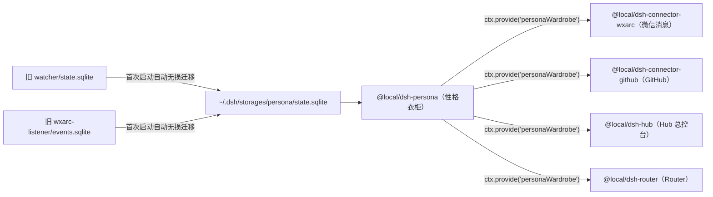
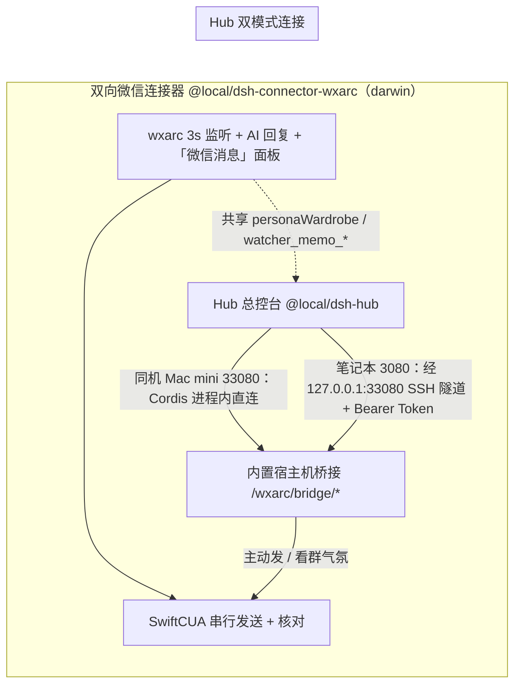

# 03 · 怎么拆分与落地步骤

> **一句话：** 整套能力彻底拆成 **6 个运行时插件 + 1 个聚合包**：独立性格衣柜（`@local/dsh-persona`）+ 纯确定性 Hub 总控台（`@local/dsh-hub`，0 LLM）+ Layer-3 Super-agent 智能大脑（`@local/dsh-router`，侧边栏「Router」）+ 独立 GitHub 连接器（`@local/dsh-connector-github`，含独立侧边栏面板）+ 双向微信连接器（`@local/dsh-connector-wxarc`，仅 macOS）+ 主动待惦记便签（`@local/dsh-trigger-memo`）+ 一键汇总包（`@local/dsh-hub-bundle`）。

---

## 一、为什么这样分：6 个插件各管一摊

### 1. `@local/dsh-persona`（独立「性格衣柜」，`id: persona`）

性格设定和学习记忆是长期资产，不应该绑死在微信里，也不该混在总控台数据库里。现在它独立成侧边栏 **「性格衣柜」**，暴露 `/local-persona/*` 路由和 `ctx.provide('personaWardrobe')` 服务：



完整保留原 wxarc 全部 **3 项学习能力** + 试聊：

1. **本人历史发言风格提炼**：喂一批你本人发过的旧消息（`/local-persona/personas/:id/learn-style`），提炼句长、措辞、语气；之后每次进门只带提炼结果，不塞原文。
2. **带原话依据的 24 / 16 聊天偏好记忆**：按「性格 + 房间（`scope`）」分开记对方明说的偏好与原话依据，最多留 **24 条**，每次进门带最近 **16 条**；支持在「性格衣柜」里手改、删除与清空；朋友圈（`sns:*`）与试聊（`/local-persona/personas/:id/preview`）绝不自动写入记忆本。
3. **本人私用 `foundation` CJK 2-gram 检索**：支持把个人背景资料导入性格资产库（`/local-persona/personas/import-foundation`），用纯 TypeScript 实现的 CJK 2-gram 相关性检索召回；**仅限本人私用上下文**，绝不向群友或外部公开仓库泄露。
4. **单一编辑入口**：人物的新增、设定修改、风格学习、24/16 记忆管理、`foundation` 导入与试聊全部收口在侧边栏 **「性格衣柜」**；「微信消息」面板与「GitHub」面板只放精简版下拉选择器 + **一键跳转「性格衣柜」** 按钮，彻底消除重复编辑入口。

### 2. `@local/dsh-hub`（纯确定性「Hub 总控台」，`id: hub`）

- **100% 纯确定性事件总线（0 次 LLM 调用）**：Hub 本身永远不调大模型，只管统一收件箱、便签本、草稿箱硬门禁（`DoorGuard`）、已接入插件总览与房间排队。
- **两级路由 + 快车道 + 管理员微信分发总线**：先查 `thread_subscriptions` 快速路由表，已有房间毫秒直达（绕过 Router）；未认领冷启动事件统一经过 `onUnclaimedEvent` 钩子交给 `@local/dsh-router`，未拦截时再按确定性门牌号落房；同时提供纯确定性的 `registerAdminWechatHandler` / `dispatchAdminWechatMessage` 钩子（按注册顺序短路认领、单处理器异常隔离），把管理员微信私聊解耦转发给 Router 等上层服务。
- **4 标签页平台无关 UI**：侧边栏 **「Hub 总控台」** 包含 **「收件箱」**（按 `entityKey` 聚合线程，Issue/PR 主楼在上、评论按原文时间正序折叠，每条显示原文时间 + 入箱时间）、**「便签本」**（置顶「进行中便签」、默认折叠历史便签，并将状态与 `proactive_budget_exhausted` 等原因码全量中文化）、**「草稿箱」**、**「已接入插件」** 4 个标签页（不再塞进任何 GitHub 或性格编辑细节）。
- **无损兼容旧库与旧路由**：同时挂载 `/local-hub/*` 与 `/local-watcher/*` 双前缀路由；未指定 `stateDir` 时，若 `~/.dsh/storages/hub/state.sqlite` 尚未创建而旧库 `~/.dsh/storages/watcher/state.sqlite` 存在，自动原地复用旧库，历史记录零丢失。

### 3. `@local/dsh-router`（Layer-3 Super-agent 智能大脑，`id: router`，侧边栏「Router」，order `10`）

架在 `@local/dsh-hub` 之上的独立智能大脑，状态独立存放在 `~/.dsh/storages/router/state.sqlite`（WAL + `STRICT` 表 + `0600` 权限）：

- **只接冷启动 + Worker 回报，绝不抢快车道**：仅订阅 `hub.onUnclaimedEvent(...)` 接管未认领冷启动事件，以及 Worker 通过 `router_report_result` 工具交回的阶段结论；一旦 Worker 登记了 `hub.registerSubscription`，该线索后续消息直接走 Hub 的 `thread_subscriptions` 快车道，零经过 Router。
- **4 级分诊 + 程序硬护栏高于 LLM**：将事件分为 `ignore` / `inform` / `prepare` / `act` 四级。程序硬护栏先于模型执行：`actor.isBot` 直接 `ignore`、紧急事件永不忽略、`untrusted` 来源最高封顶 `prepare`、模型异常或超时时自动 **fail-open** 保底通知绝不静默丢消息；被过滤的条目支持一键点 **「仍然通知」** 恢复。
- **注意力与作息路由 + 单焦点管理员微信双向协作**：按时段（`work` / `off_hours` / `weekend`）、在席状态（`auto` 2 分钟网页活跃检测 / `present` / `away`）与紧急直达覆盖决定送 Web、转微信或延后；微信目标在保持默认 `filehelper`（或留空）时自动对齐 `wxarc` 的管理员微信号 `controllerId`（显式配置其他会话 ID 时尊重配置，面板仍支持从 `/wxarc/automation` 下拉选择）。为避免打扰，普通非紧急 `inform` 仅留网页箱（`inform_web_only`），`prepare`/`act` 等 Worker 调用 `router_report_result` 后再推微信；微信侧采用**单焦点模式**（一次只专注 1 个焦点 Issue，其他非紧急项排入 `queued_behind_focus`，24 小时无交互自动释放），并通过 `hub.registerAdminWechatHandler` 接管管理员私聊，支持直接回话或引用 `[#编号]` 原路送进 Worker 续聊/改代码，以及「列表」「下一个」「跳过」「先放着」「完成」「#编号」等指令，无焦点时普通聊天放行不误拦。内置 **「情境预演」** 模拟器（`POST /local-router/preview`）与 60 秒幂等延迟巡检（有活跃焦点时跳过插嘴，无焦点时推出下一条）。
- **实物/截图回报与全链路简体中文 4 标签页 UI**：Worker 简报约束大白话 ≤ 200 字、不往业务仓库乱写分析 `.md`，`router_report_result` 支持可选 `imagePath`（本地 PNG/JPEG 截图，≤ 8 MB）、`draftText`（拟发原文）、`blindspot`（未测边界）与 `mode`（`discuss`/`review_draft`/`done`），多轮汇报采用独立幂等后缀不碰撞；前端将系统策略码（含 `queued_behind_focus`、`inform_web_only`、`worker_pending_report`）全量中文化；暴露 `/local-router/*` 接口，聚合 7 天 / 30 天效果统计；侧边栏 **「Router」**（order 10）提供 4 个标签页：**「分诊」**（置顶「待你拍板」，同线程按 Issue/PR 主楼在上 + 评论按发生时间正序折叠，每条显示原文时间 + 分析时间）、**「提醒队列」**、**「注意力与作息」**、**「效果与快车道」**。

### 4. `@local/dsh-connector-github`（独立双向 GitHub 连接器，`id: connector-github`）

GitHub 不再寄居在总控台标签页里，拥有自己独立的侧边栏面板 **「GitHub」** 与 `/connector/github/*` 路由：

- **认证与无损凭证回退**：支持 Read Token 与原生 **GitHub App 机器人（`<slug>[bot]`）**（`node:crypto` RS256 JWT + 1 小时自动轮换安装令牌）；读取 `~/.dsh/.credentials.yaml` 时优先查 `connector-github/*`，找不到自动回退旧 `watcher-github/*`（与 `gh-watch/*`）及本机 `gh auth token`。
- **性格卡绑定**：在「GitHub」面板可配置全局默认性格卡与每个仓库的专属性格卡，并支持一键跳转「性格衣柜」。
- **3 标签页 UI 与持久化事件箱**：侧边栏 **「GitHub」** 分为 **「事件箱」**（默认首页）、**「仓库与盯防」**、**「账号与高级设置」** 3 个标签页；`/connector/github/events` 合并内存与 Hub SQLite 持久化记录（重启不丢），按 Issue/PR 主楼在上 + 评论按发生时间正序折叠展示，并同时呈现原文时间与拉取时间；仓库轮询在 `source_cursors` 持久化 Issue/PR 快照，`updated_at` 变化时按 `since` 增量拉取 `/issues/{number}/comments` 补齐真实评论人与正文摘录，且仅在标题/状态/Draft/标签/正文实质变更时发出更新事件；同时保留 `/notifications` + ETag 轮询（含 👍 点赞增量）、重点盯防热生效与 `git merge-tree` 冲突预检。

### 5. `@local/dsh-connector-wxarc`（双向 macOS 微信连接器，`id: connector-wxarc`，仅 `darwin`）

把微信监听、AI 回复、SwiftCUA 发送、Web UI **「微信消息」** 面板与 Hub 桥接合一放进单个 `darwin`-only 连接器：

1. **完整保留微信闭环**：每 3 秒看一眼新消息、DSH AI 按性格衣柜写回复（收图 `ImageReader.enrich` 识别 `wxarc` `/ui/refresh` 的 `media.variant` 或低清缩略图体积/分辨率特征，35 秒宽限期内抛 `WXARC_IMAGE_PENDING` 等待大图落盘入库而不锁死缩略图缓存，超时后降级放行并在模型提示中附注「当前仅获取到低清缩略图，细节可能不清」）、SwiftCUA 串行辅助功能发送并核对（`openChat` 切会话若会话列表被遮挡 `OBSTRUCTED` 自动安全降级走 `Cmd+f` 搜索切会话；群内原生 `@` 支持长昵称省略号前缀唯一匹配与 OCR 诊断日志，遇到群内重名或菜单无法唯一核对时自动取消原生 `@` 并保留引用/直接回复，绝不漏回也不 `@` 错人）、不确定时标「待核实」绝不乱重发、`/wxarc/*` 接口、6 个 `.py`/`.jxa` 辅助脚本、默认复用 `stateDir: ~/.dsh/wxarc-listener` 无缝承接旧本地库与游标、精简版性格选择器（一键跳转「性格衣柜」）。
2. **原生内置 Hub 桥接、发图能力与管理员私聊分发**：同包提供 `/wxarc/bridge/*` 宿主机路由、双模式 `WechatTransport`（同机 Cordis / 远程 SSH 隧道，`status()` 双模式均透出管理员微信号 `controllerId`）、`wxarc.send` 出口、`wxarc_proactive_send` 主动外发工具、`githubToWechatRule` 跨通道提醒规则，并直接联动 `personaWardrobe` 与 `watcher_memo_*` 便签工具；主动发送（`sendProactive` / `/wxarc/bridge/send` / `WechatTransport.send`）支持可选 `imagePath`（复用 `loadLocalImage` 做绝对路径、PNG/JPEG、≤ 8 MB 与魔数校验，在同一串行队列内先发文字再发截图；仅在 `sentSteps === 0` 且 `clicked_at === null` 的纯前置准备阶段遇 `OBSTRUCTED` 等可重试错误时按 `2s / 5s` 自动重试最多 2 次，一旦点击或进入 `sending`/`uncertain` 绝不重放）；收到管理员 `controllerId` 私聊时自动附带引用上下文调 `hub.dispatchAdminWechatMessage`，认领后异步回传结果，未认领则无缝放行原有聊天流程。



| 场景 | 管子怎么连 | 安全红线 |
|---|---|---|
| **Mac mini 本机（端口 `33080`）** | Hub 与 `@local/dsh-connector-wxarc` 在同一个 DSH 进程里，直接走 Cordis 内存服务（`mode: 'cordis'`） | 只操作小号 `ownId` |
| **笔记本（端口 `3080`）** | 走现有的 `127.0.0.1:33080` SSH 隧道调 `/wxarc/bridge/*`（`mode: 'http'`，带 Bearer Token） | **硬拦截**本机个人微信 `127.0.0.1:8765` 与个人微信号 `ownId`，非回环地址默认拒绝 |

### 6. `@local/dsh-trigger-memo`（3 模式主动待惦记便签，`id: trigger-memo`）

负责 `time_nudge`（时间窗提醒；微信便签到点优先经 `triggerMemoNudge` 回流到对应的原微信 DSH 会话，由分身按性格卡组织自然口吻并通过群成员列表原生 `@` 发出，完整记录留在原微信会话而不再另开 Router Worker，仅在无会话桥接时回退直发；主动消息额度默认按自然日 `calendar_day` 计数、滚动模式默认 `18` 小时，额度暂满且未过窗口时自动顺延至额度恢复后触发而非直接撕毁）、`news_followup`（新闻增量追踪 3 天）、`long_watch`（长期蹲守如 #223，只认官方公告）三种主动便签调度，通过 `ctx.inject(['tools'])` 向 DSH 注册 `watcher_memo_add` / `watcher_memo_list` / `watcher_memo_cancel`（含 DSH `0.2.2` `parameters`/`output` Schema），微信会话里要求未来提醒时优先走便签本而非仅停留在网页的 DSH 原生定时任务。

### 两张常见性格卡对比（均在「性格衣柜」统一维护）

| | 微信「家人群」性格卡 | GitHub「自研仓库」习惯卡 |
|---|---|---|
| 身份 | 小岚，家里的贴心助手 | 代码审查员 / 分诊助手 |
| 说话方式 | 口语、短句、偶尔带表情 | 先说结论，再列问题，附文件和行号 |
| 能做的事 | 聊天、记待惦记便签、到时候问一句 | 看代码、写评论、总结 PR |
| 重点关注 | 别太啰嗦，别聊工作 | 测试有没有跟上、与主分支有没有冲突 |
| 什么时候叫你 | 不叫 | 有人请你审查、#223 官宣了、出现急事 |

---

## 二、真实目录结构（6 个运行时插件 + 1 个聚合包）

整个仓库是 100% 严格模式 TypeScript（`.ts`）ESM Monorepo，只使用 Node 24 内置模块（含 `node:sqlite` 与 `node:crypto`），零第三方运行时依赖，且所有 `.ts` 文件保持零注释：

```text
dsh-watcher/
├── docs/                                唯一权威文档（01–05）
├── scripts/
│   ├── check-no-comments.ts             AST 级零注释检查脚本（不误报模板字符串里的 https://）
│   └── deploy-macmini.ts                基于 .env.deploy 的一键验证、打包、上传与重启脚本（零硬编码主机）
└── packages/
    ├── dsh-persona/                     @local/dsh-persona（Cordis ID: persona，侧边栏「性格衣柜」）
    │   └── src/
    │       ├── contracts.ts             PersonaWardrobe 共享契约类型
    │       ├── db.ts                    独立 SQLite 状态库（~/.dsh/storages/persona/state.sqlite）+ 首次启动无损自动迁移
    │       ├── wardrobe.ts              风格提炼、24/16 带原话依据偏好学习、本人私用 foundation CJK 2-gram 检索与试聊
    │       ├── http-routes.ts           /local-persona/* 本地管理接口
    │       ├── client.ts                经典 IIFE 前端入口（注册侧边栏「性格衣柜」面板）
    │       └── index.ts                 Cordis 插件入口（ctx.provide('personaWardrobe')）
    ├── dsh-hub/                         @local/dsh-hub（Cordis ID: hub，侧边栏「Hub 总控台」，0 LLM 调用）
    │   └── src/
    │       ├── contracts.ts             Hub 统一事件、连接器、订阅与出口契约
    │       ├── db.ts / schema.sql       SQLite 状态库（16 张 STRICT 表，含 thread_subscriptions 与独占租约，自动复用旧 watcher/state.sqlite）
    │       ├── guard.ts                 门口小保安 DoorGuard（2 个默认放行钩子）
    │       ├── session-bridge.ts        DSH 房间创建、唤醒、人工接管与重启恢复
    │       ├── posterior.ts             路由规则、分诊提示词、/watch 命令与房间工具
    │       ├── service.ts               纯确定性事件总线（thread_subscriptions 快车道、onUnclaimedEvent、管理员微信分发总线、草稿箱、外发）
    │       ├── http-routes.ts           /local-hub/* 与 /local-watcher/* 双前缀本地管理接口
    │       └── client.ts                经典 IIFE 前端入口（4 标签页：收件箱、便签本、草稿箱、已接入插件）
    ├── dsh-router/                      @local/dsh-router（Cordis ID: router，侧边栏「Router」，order 10）
    │   └── src/
    │       ├── contracts.ts             4 级分诊、注意力策略、Worker 回报与统计契约
    │       ├── db.ts                    独立 SQLite 状态库（~/.dsh/storages/router/state.sqlite，STRICT 表 + 7d/30d 统计聚合）
    │       ├── policy.ts                作息与在席策略引擎（work/off_hours/weekend、auto/present/away、紧急直达与情境预演）
    │       ├── triage.ts                4 级分诊（ignore/inform/prepare/act）+ 程序硬护栏优先 + 模型异常 fail-open
    │       ├── worker-dispatcher.ts     Worker 房间派发、hub.registerSubscription 快车道登记与 router_report_result（含 imagePath/draftText/blindspot/mode）
    │       ├── service.ts               订阅 hub.onUnclaimedEvent 与管理员微信处理器，单焦点排队（24h 释放）、自动对齐 controllerId、60 秒幂等延迟投递与统计
    │       ├── http-routes.ts           /local-router/* 本地管理接口（status/decisions/restore/dispatch/answer/notifications/policy/preview/stats/subscriptions）
    │       ├── client.ts                经典 IIFE 前端入口（注册侧边栏「Router」order 10，4 标签页：待处理 & 分诊、网页提醒、注意力与作息、效果统计 & 快车道）
    │       └── index.ts                 Cordis 插件入口（inject: ['hub']，60 秒延迟投递定时巡检）
    ├── dsh-connector-github/            @local/dsh-connector-github（Cordis ID: connector-github，侧边栏「GitHub」）
    │   └── src/
    │       ├── auth.ts                  原生 GitHub App 机器人（node:crypto RS256 JWT + 1h 安装令牌）、connector-github/*（自动回退 watcher-github/*）与 gh CLI 兜底
    │       ├── poller.ts                /notifications + ETag 轮询（含 👍 增量、原始事件流环形缓冲与运行中热更新）
    │       ├── graph-resolver.ts        Issue/PR 合住与便签图谱 + git merge-tree 冲突预检
    │       ├── sink.ts                  默认进 Hub 草稿箱、按 autoSendOwners/单仓 autoSend 自动直发、App 身份保留本人 PR APPROVE/REQUEST_CHANGES 与 gh_stage_reply/review
    │       ├── http-routes.ts           /connector/github/* 本地管理接口（含 /events、/personas、/app*、/token、/config、/poll）
    │       └── client.ts                经典 IIFE 前端入口（注册独立侧边栏「GitHub」面板：认证、性格卡绑定、仓库配置、原始事件流）
    ├── dsh-connector-wxarc/             @local/dsh-connector-wxarc（Cordis ID: connector-wxarc，侧边栏「微信消息」，仅 darwin）
    │   └── src/
    │       ├── index.ts                 双向微信连接器入口、/wxarc/* 与 /wxarc/bridge/* 路由（默认 stateDir: ~/.dsh/wxarc-listener）
    │       ├── automation.ts / agent.ts wxarc 3s 监听、管理员私聊分发、文字+截图串行主动发（sendProactive）、DSH AI 回复与共享 personaWardrobe / watcher_memo_* 联动
    │       ├── outgoing-image.ts        loadLocalImage 本地 PNG/JPEG 截图安全校验（绝对路径、≤ 8 MB、文件头魔数核验）
    │       ├── cua.ts / sender.ts       SwiftCUA 串行辅助功能发送、表情/图片处理与发送核对
    │       ├── host-side-bridge.ts      宿主机 /wxarc/bridge/* 服务（透出 controllerId、支持 imagePath、队列串行、Bearer 校验、不重发）
    │       ├── transport.ts             双模式 WechatTransport（Cordis / HTTP 隧道，透出 controllerId 与 imagePath）+ 群气氛判断 + 8765 硬拦截
    │       ├── send-sink.ts             wxarc.send 出口、wxarc_proactive_send 工具与 githubToWechatRule 路由
    │       ├── client.ts                经典 IIFE 前端入口（注册侧边栏「微信消息」面板，精简人物选择器 + 一键跳转「性格衣柜」）
    │       └── *.py / *.jxa（共 6 个）   辅助脚本（article-parser.py、clipboard.jxa、contacts.py、desktop-layout.jxa、image-pixels.py、mention-source.py）
    ├── dsh-trigger-memo/                @local/dsh-trigger-memo（Cordis ID: trigger-memo）
    │   └── src/
    │       ├── store.ts                 便签表、已看链接去重、自然日 / 18h 滚动主动开口预算与恢复时间计算
    │       ├── web-scout.ts             新闻增量过滤与长期官宣白名单核查
    │       ├── scheduler.ts             time_nudge / news_followup / long_watch 调度器
    │       └── tools.ts                 房间工具 memo_add / memo_list / memo_cancel
    └── dsh-hub-bundle/                  @local/dsh-hub-bundle（一键聚合包）
        ├── cordis.patch.yml             DSH 启动清单（按 persona → hub → router → connector-github / trigger-memo / connector-wxarc 顺序加载，适配 autoInstallPeers: false）
        └── test/e2e.test.ts             跨 7 包端到端集成测试（覆盖真实主链路）
```

---

## 三、落地状态与常用命令

目前 **6 个运行时插件 + 1 个聚合包** 已经全部落盘并通过各包单元测试与跨包端到端测试：

1. **独立性格衣柜（`@local/dsh-persona`）**：独立库 `~/.dsh/storages/persona/state.sqlite` 首次启动自动无损导入旧库数据；侧边栏 **「性格衣柜」** 集中承载风格提炼、24/16 带原话依据的偏好记忆、本人私用 `foundation` CJK 2-gram 检索与试聊。
2. **纯确定性 Hub 总控台（`@local/dsh-hub`）**：0 LLM 调用；侧边栏 **「Hub 总控台」** 提供收件箱、便签本、草稿箱与已接入插件 4 个标签页；通过 `thread_subscriptions` 快车道直达（绕过 Router），未认领冷启动事件走 `onUnclaimedEvent`，并提供 `registerAdminWechatHandler` / `dispatchAdminWechatMessage` 管理员微信分发总线；双路由 `/local-hub/*` + `/local-watcher/*` 并自动复用旧 `watcher/state.sqlite`。
3. **Layer-3 Super-agent 智能大脑（`@local/dsh-router`）**：独立库 `~/.dsh/storages/router/state.sqlite`；订阅 `hub.onUnclaimedEvent(...)`、Worker 的 `router_report_result` 回报（支持 `imagePath` 截图、`draftText` 拟发原文、`blindspot` 未测边界与 `mode`）以及管理员微信处理器；提供 4 级分诊（`ignore`/`inform`/`prepare`/`act`）+ 程序硬护栏 + fail-open + 一键「仍然通知」、作息与在席注意力路由（默认 `filehelper` 自动对齐 `controllerId`、普通非紧急 `inform` 留网页箱、单焦点排队与 24h 自动释放、微信双向指令与续聊、紧急直达、「情境预演」、60 秒幂等延迟投递）、7d/30d 效果统计、`/local-router/*` 路由与侧边栏 **「Router」**（order 10）4 标签页 UI（分诊 / 提醒队列 / 注意力与作息 / 效果与快车道）。
4. **独立 GitHub 双向连接器（`@local/dsh-connector-github`）**：侧边栏独立 **「GitHub」** 面板（`/connector/github/*`），一站管理 Read Token 与原生 **GitHub App 机器人**（`connector-github/*` 自动兼容回退旧 `watcher-github/*`）、全局默认与按仓库性格卡绑定（一键跳转「性格衣柜」）、监听仓库 / 重点盯防条目 / `autoSendOwners` 热配置与最近原始事件流（`/connector/github/events`）；默认 `autoSendOwners: []`（全部仓库先入 Hub 草稿箱），按需在面板开启自动直发。
5. **双向微信连接器 + 主动待惦记便签（`@local/dsh-connector-wxarc` + `@local/dsh-trigger-memo`）**：`@local/dsh-connector-wxarc` 保持 3 秒轮询、AI 回复（支持群聊按成员列表主动原生 `@` 最多 3 位群成员并在重名/OCR 失败时逐人安全降级）、SwiftCUA 串行发送（含 `sendProactive` / `/wxarc/bridge/send` / `WechatTransport.send` 文字+本地 PNG/JPEG 截图串行发送、`loadLocalImage` 魔数校验与 `sending`/`uncertain` 不重放）、`status()` 透出 `controllerId` 与管理员私聊经 `hub.dispatchAdminWechatMessage` 分发、6 个 `.py`/`.jxa` 资产与双模式桥接（硬拦截 `8765`）；`@local/dsh-trigger-memo` 跑通 `time_nudge`、`news_followup` 与 `long_watch` #223 三种模式。

在 `dsh-watcher/` 根目录执行：

```bash
pnpm install
pnpm run build
pnpm test
pnpm run check:comments
```

### DSH `0.2.2-rc.1` 宿主机部署适配要点（Mac mini 已验证）

1. **启动顺序与 Cordis `4.1.0` 可选服务访问**：`dsh-hub-bundle/cordis.patch.yml` 按 `persona → hub → router → connector-github / trigger-memo / connector-wxarc` 顺序加载，保证 `personaWardrobe`、`hub` 与 `router` 就绪后再挂载连接器与触发器。各包均通过 `ctx.inject(['webServer'], ...)` 按需挂载路由（`/local-persona`、`/local-hub` + `/local-watcher`、`/local-router`、`/connector/github`、`/wxarc` + `/wxarc/bridge`），其余可选服务通过 `ctx.get(...)` 读取，避免未注入属性触发 Cordis 代理报错。
2. **凭证存储（`$DSH_HOME/.credentials.yaml`，`0600`）**：`@deepseek-ai/dsh-credentials-local` `0.2.2-rc.1` 使用 `readRecord("<scope>/<id>")` 与 `resolve("<POSIX_REF>")`。`connector-github` 优先读 `connector-github/*`（如 `connector-github/github-app`、`connector-github/github-read`），未找到时自动回退旧 `watcher-github/*` 与 `gh-watch/*` 记录以及本机 `gh auth token`，平滑升级无需重填凭证。
3. **打包与热更新**：**6 个运行时插件**（`@local/dsh-persona`、`@local/dsh-hub`、`@local/dsh-router`、`@local/dsh-connector-github`、`@local/dsh-trigger-memo`、`@local/dsh-connector-wxarc`）通过 `pnpm pack --pack-destination dist-tgz` 打包后，以 `dsh plugin --profile web add <6 个 .tgz>` 一次性安装并由 `launchctl kickstart -k gui/501/local.dsh-web` 生效（同版本号覆盖更新需先 `remove` 再 `add` 以跳过 pnpm 本地包缓存；非 macOS 宿主机自动忽略 `darwin`-only 的 `@local/dsh-connector-wxarc`）。仓库亦提供基于 `.env.deploy`（见 `.env.deploy.example`）的一键部署命令 `pnpm run deploy:macmini`，自动完成干净树检查、注释检查、构建测试、打包上传、重装重启与写 `~/.dsh/dsh-watcher.deployed-rev`。
4. **浏览器客户端脚本构建**：DSH 浏览器端通过 `plugins/??...` 将插件客户端代码作为经典 `<script>` 合并执行，不能包含 ES Module `export` / `import` 语句。5 个带侧边栏 UI 的插件（`@local/dsh-router`「Router」order 10、`@local/dsh-persona`「性格衣柜」、`@local/dsh-hub`「Hub 总控台」、`@local/dsh-connector-github`「GitHub」、`@local/dsh-connector-wxarc`「微信消息」）均通过各自独立的 `tsconfig.client.json`（`module: "none"`, `moduleDetection: "legacy"`, `verbatimModuleSyntax: false`）将 `src/client.ts` 编译为无 `export` 的经典 IIFE 脚本 `lib/client.js`，并由 `node:vm` 的 `vm.Script` 测试做经典脚本加载回归校验。

---

**下一篇：** [04-以后再加的安全门禁](./04-以后再加的安全门禁.md)：门口已经预留好的两个默认放行钩子，以后怎么零改动扣上去。
