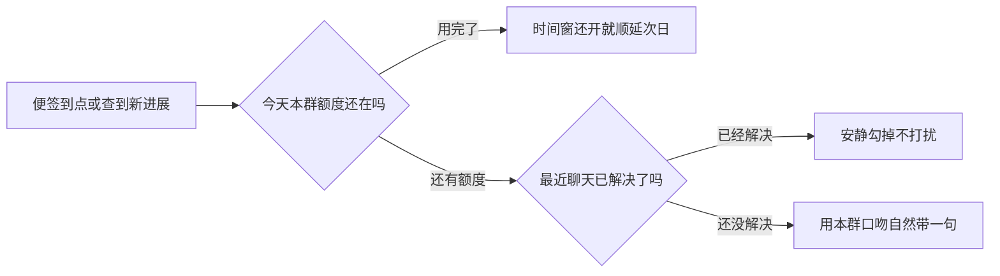

# 05 · 待惦记便签怎么主动开口

> AI 怎么把需要惦记的事记成便签，并在合适的时机自然开口提醒你。

---

## 一、为什么要有「待惦记便签」

普通手机闹钟只管到点响铃，不管大家刚才聊没聊过、事情有没有解决。哪怕群里十分钟前刚说完「服务器已经续好了」，闹钟三点一到还是会生硬蹦出来催你。

「待惦记便签」更像一个懂事的朋友帮你把事记在心里：

- **不只盯着表盘**：到时间前会先扫一眼最近的聊天记录，事情已经解决就悄悄划掉，绝不出来放马后炮。
- **会主动去外面打听**：如果惦记的是某条悬而未决的新闻，它会自己隔几小时搜一圈最新进展，有真变化才告诉你。
- **能沉住气长期蹲守**：如果等的是某款产品的发售日或官方正式发布，它会隔几天看一眼官方公告，没官宣就安安静静等着。

你在微信里随口交代一句，或者在网页侧边栏「Hub 总控台」的「便签本」里手动记一笔，都能生成一张待惦记便签。

---

## 二、3 种便签模式与生活例子

不同事情需要不同的盯法，系统把待惦记便签分成了 3 种模式：

| 模式 | 适合什么事 | 平时怎么检查 | 什么时候开口 |
|---|---|---|---|
| **定时轻提醒** | 有明确时间段的小事 | 到时间段后挑一个自然时刻 | 确认群里还没提过，顺口问一句 |
| **追新闻后续** | 刚聊到的热点或悬念 | 每隔几小时上网搜一次进展 | 查到真正的新进展且气氛合适时说一次 |
| **长期蹲守** | 等某次正式发布或官宣 | 每隔几天看一眼官方渠道 | 没官宣就安静等着，官宣后立刻告知 |

### 例子 1：定时轻提醒

你在项目群里说：「明天下午帮我提醒大家续费测试服务器。」或者周五早上跟助理说：「下午问问演示顺不顺利。」

AI 不会卡着整点像机器人一样弹一句「提醒时间到」，而是在这个时间段里挑一个自然的空档顺口带一句。如果整个时间段过去了都没能发出，便签会自动作废，绝不会隔天补发一句过时的马后炮。

### 例子 2：追新闻后续

项目群里聊到一款大家都在用的工具突然跳票了，但官网还没给新日期。记下「追新闻后续」便签后，接下来两三天里，AI 会隔几个小时上网搜一次最新报道。

每次搜完都会和之前已经知道的旧消息做对比，看过的网页链接也会记账去重。只有确认出现了真正的新进展，才会去群里同步一次；如果全是重复报道，就继续保持安静。

### 例子 3：长期蹲守

你一直在等某款游戏的发售日，或者某个开源项目的正式版官宣，具体哪天发布谁都说不准。

记下「长期蹲守」便签后，AI 每隔几天只会去核对官方公告或发布页，不听论坛里的小道传闻。没官宣就一直安静蹲着；一旦官方正式发布，它会立刻在原聊天里通知大家，也能顺带发一条微信私聊专门叫你。

---

## 三、怎么开口才不讨厌

主动开口最怕两件事：一是没眼力见儿乱插话，二是接连弹出好几条刷屏。每张便签到点准备说话前，都要先过一遍礼貌检查：

具体有四条礼貌规矩：

- **先看聊没聊过**：准备发言前先读一遍最近聊天，如果大家已经把这件事谈完或解决了，直接把便签勾掉收尾，不打扰任何人。
- **用本群口吻自然带一句**：确实还没解决时，会贴合当前群的说话风格和人设自然开口，需要点名时轻柔 `@` 相关的人，听起来像熟人顺嘴问一声。
- **每个群每天克制发言**：每个群默认每天最多由便签主动挑起一次话题，避免一上午连蹦三条提醒惹人烦。如果当天额度用完但提醒时间窗还没关，就会乖乖顺延到次日再说。
- **绝不重复念叨**：每条便签发出前都会做好去重登记，已经提醒过的事和已经看过的报道绝不会反复拿出来说。

---

## 四、日常怎么记、怎么查、怎么取消

你不用背复杂格式，在日常聊天或网页里怎么顺手怎么来：

- **群里直接交代**：在项目群里说「周四下午提醒大家核对接口」，AI 会自动把便签绑在项目群上。
- **私聊里隔空安排**：在你的私人助理对话框里说「帮家人群记一个周末买车票的提醒」，或者「看看现在有哪些待惦记的事」，一次管完所有群。
- **网页便签本手动管**：打开侧边栏「Hub 总控台 → 便签本」，能一眼看到所有进行中和已完成的便签，也能点按钮立刻核查一次或手动取消。

---

## 五、谁能管哪些群的便签

便签关系到「替哪个群记事、往哪个群发话」，权限划得很清楚：

| 你在哪里发话 | 能查看哪些便签 | 能新增或取消哪些便签 |
|---|---|---|
| **普通群聊里** | 只能看本群自己的便签 | 只能新增或取消本群自己的便签 |
| **后台专项任务里** | 只能看当前任务绑定的便签 | 可信任务只能管自己，外部不可信任务禁止增删 |
| **主人私聊或本地面板** | 可总览所有群与任务的便签 | 可替任意指定群新增或取消便签 |

- **跨群操作必须唯一核对群名**：当你在私聊里说「帮项目群记一个周五提醒」，系统会去通讯录核对群名。如果找不到，或者同时有两个名字相近的群，系统会直接拒绝并请你写清楚，绝不替你瞎猜，也不会悄悄改成发给你自己。
- **取消便签要对号入座**：删便签时会同时核对编号和所属群，想从 A 群删 B 群的便签会直接失败，且不会暴露别的群有没有这条便签。
- **临时子助手不能越权**：后台任务派生出来的子助手无权新增、查看或取消任何便签，确保提醒权只握在顶层会话手里。
- **查历史同样守圈层规矩**：在统一资料库里搜历史便签时，结果严格按所在群的圈层隔离，具体规则可看 [06-安全防线与隐私边界](./06-安全防线与隐私边界.md)。

---

**上一篇：** [04-性格衣柜与查资料](./04-性格衣柜与查资料.md)　**下一篇：** [06-安全防线与隐私边界](./06-安全防线与隐私边界.md)
