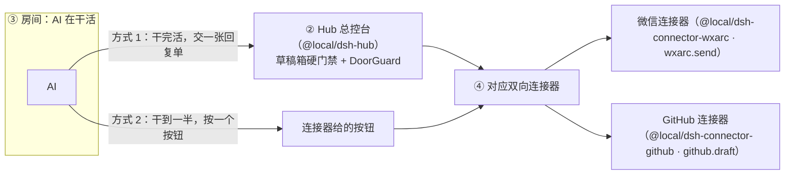
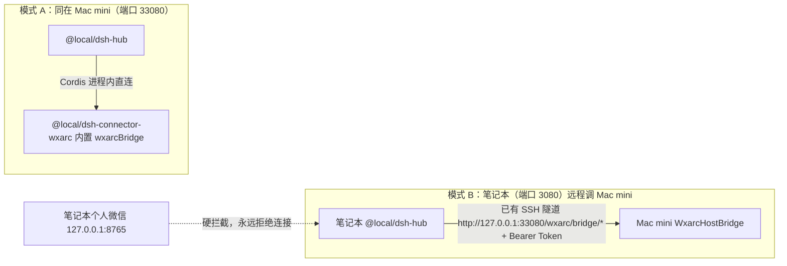
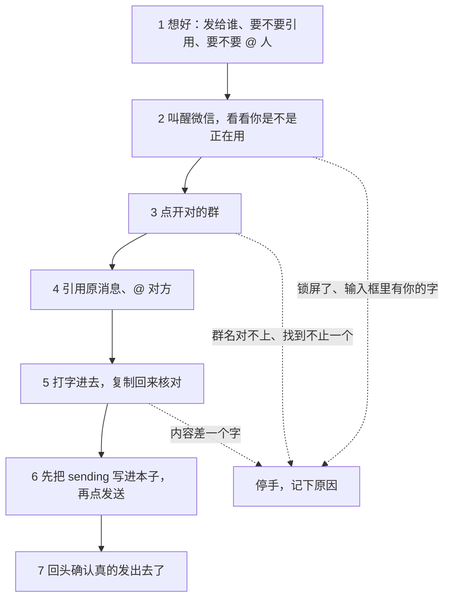
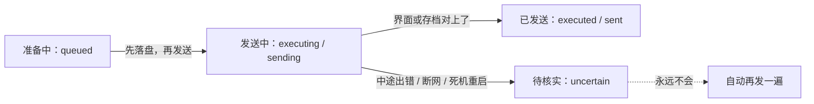
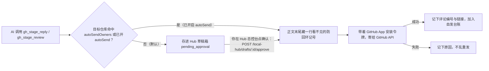

# 05 · 消息怎么真正发出去

> **一句话：** 微信没有官方的发消息口子，只能**像真人一样在 Mac 上点鼠标、敲键盘**把话发出去；GitHub 有官方口子，**直接寄一封网络请求**就行。
>
> **默认外发规则：** 默认 `autoSendOwners: []`，所有仓库的外发评论/审查**一律先存 Hub 草稿箱**，你在侧边栏 **「Hub 总控台 → 草稿箱」** 点确认后才真正寄出；在侧边栏 **「GitHub」** 面板配置 `autoSendOwners` 或把单个仓库设为 `autoSend: true` 后即可对该范围开启**自动直发**。

前 4 篇讲到「交给连接器发出去」就停了。这一篇把两个双向连接器的外发出口拆开，看里面到底怎么发、怎么连机器、怎么防止重复发。

---

## 一、AI 写完后，怎么把内容交出来？

一共两种交法。



### 方式 1：交一张回复单（最常用）

AI 在房间里把活干完，最后交回一张很短的「回复单」。Hub 总控台拿走，经门禁后原样交给对应连接器。

```text
动作：  回复
内容：  第一条「去爬山！」 / 第二条「顺便把烧烤补上」
引用：  回最后一条 @ 我的消息
```

回复单上能写的东西：

| 想发什么 | 怎么写 | 限制 |
|---|---|---|
| 一段话 | 动作写「回复」，内容写一段 | 最多 1500 字 |
| 分几条发 | 内容写成几段 | 最多 5 条，加起来不超过 1500 字 |
| 一张图 | 把图存进房间自己的文件夹，单子上写文件名 | 只能是 PNG 或 JPEG，不超过 8 MB，一次一张 |
| 一个表情包 | 先用「找表情」按钮挑好，单子上写挑的是第几个 | 一次一个；发不出去就改发备用的那句话 |
| 不回 | 动作写「不回」 | — |

**注意：** 所有外发消息都必须经过 Hub 总控台的 `invokeSink` 和门口小保安的 `beforeSendOut` 钩子再交到连接器，AI 自己不能偷偷绕过出口发消息。

### 方式 2：干到一半，按一个按钮

双向连接器给房间里的 AI 放了几个工具按钮（均限制只有根会话可以调用，子代理禁止外发）：

| 按钮（工具名） | 所属插件 | 干什么 | 会不会直接发出去 |
|---|---|---|---|
| `router_report_result` | `@local/dsh-router` | Worker 干完活向管理员汇报结论，可选附带 `imagePath`（本地 PNG/JPEG 截图，≤ 8 MB）、`draftText`（对外拟发原文）、`blindspot`（未测边界）与 `mode` | 由 Router 按作息与单焦点规则投递到网页提醒或管理员微信（每轮独立刷新确认题/选项、同焦点续发走紧凑格式省去重复链接与提示尾；不会直接发到外部群或外部 GitHub 仓库） |
| `wxarc_proactive_send` | `@local/dsh-connector-wxarc` | 主动发微信（待惦记便签到点问一句、#223 官宣提醒你、GitHub 急事叫你） | 默认先存 Hub 草稿箱（`requireApprovalByDefault: true`）；开启直发或便签跨通道提醒且通过 `ownId` 与白名单核验后才直接发 |
| `gh_stage_reply` | `@local/dsh-connector-github` | 在 Issue 或 PR 下面回一条评论 | **默认只存 Hub 草稿箱**，你点头才发；在「GitHub」面板配置 `autoSendOwners` 或单仓 `autoSend: true` 后直接发（也可传 `stageOnly: true` 强制存草稿） |
| `gh_stage_review` | `@local/dsh-connector-github` | 给 PR 写一段总评，可选在某文件某行留言 | **默认只存 Hub 草稿箱**；已开启 `autoSend` 的仓库直接发（配置原生 GitHub App 后以 `<slug>[bot]` 机器人身份发声，**保留本人 PR 的 `APPROVE`/`REQUEST_CHANGES`**；仅回退到个人账号 Token 时才自动降级为 `COMMENT`） |

---

## 二、具体怎么发到微信？（双模式桥接 + 7 步 GUI 发送）

### 1. 怎么连到跑微信的 Mac mini（双模式连接）

双向微信连接器 `@local/dsh-connector-wxarc`（Cordis ID `connector-wxarc`，侧边栏 **「微信消息」**，仅 `darwin`）内置 `WechatTransport`，自动支持两种连法（`mode: 'auto' | 'cordis' | 'http'`）：



| 项 | 模式 A（Mac mini `33080` 同机直连） | 模式 B（笔记本 `3080` 走隧道） |
|---|---|---|
| 触发条件 | 同一 DSH 进程里有 `wxarcBridge` Cordis 服务 | 本机没有 `wxarcBridge`，走 `remoteBaseUrl`（默认 `http://127.0.0.1:33080`） |
| 通信方式 | 内存直接调用；`status()` 透出管理员微信号 `controllerId`，`send()` 透传 `imagePath` | 走已有 `127.0.0.1:33080` SSH 隧道调 `/wxarc/bridge/status`（同样透出 `controllerId`）、`/recent`、`/send`（支持 `imagePath`），请求头带 Bearer Token（恒定时间比对） |
| 硬安全边界 | 校验 `ownId` 必须等于小号、不得在 `blockedOwnIds` 中 | **硬拦截 `127.0.0.1:8765`**（笔记本个人 wxarc）；默认拒绝非回环域名/局域网 IP；同样校验 `ownId` |

> `status()` 在 Cordis 与 HTTP 双模式下都会透出管理员微信号 `controllerId`，供 `@local/dsh-router` 在 `wechatTarget` 保持默认 `filehelper` 时自动对齐管理员本人，不需要手动复制微信号。

### 2. 宿主机上怎么真的点出去（7 步核对）

微信没有给外人用的发消息口子，所以 Mac mini 上的 `@local/dsh-connector-wxarc` 内置 SwiftCUA 与 6 个 `.py`/`.jxa` 辅助脚本（默认复用 `stateDir: ~/.dsh/wxarc-listener`），用「辅助功能」权限替人看屏幕、点鼠标、敲键盘，**每做一步都要重新看一眼、核对一遍**，任何一步对不上就停手：



- **串行排队与被遮挡自愈**：整个宿主机桥接同一时间只发一条（`enqueueSerialized` / `proactiveQueue`），避免两路并发抢鼠标键盘；若表情面板正被占用（`stickers.lease`）直接跳过不硬抢。切会话 `openChat` 若在点击会话列表项时命中 `OBSTRUCTED`（会话列表被浮窗遮挡），会先重检无草稿并安全降级走 `Cmd+f` 键盘搜索切会话。
- **文字 + 截图串行主动发送（`imagePath`）与前置重试**：`sendProactive`、`/wxarc/bridge/send` 与 `WechatTransport.send` 均支持可选 `imagePath`（可仅发文字、仅发图片或「先发文字分段、再发截图」）。发送前由 `loadLocalImage` 严格校验本地绝对路径、`.png`/`.jpg`/`.jpeg` 后缀、普通文件且 ≤ 8 MB，并核对文件头二进制魔数与扩展名一致；通过校验后在同一个 `proactiveQueue` 串行队列内复用 `cua.prepare` 与 `prepareImage` 发出。仅当 `sentSteps === 0`（尚未点击发送键、`clicked_at === null`）且前置准备抛出 `OBSTRUCTED` 或可重试前置错误时，单次任务内短暂等待后自动重试最多 2 次（默认 `2000ms`、`5000ms`）；一旦开始点击或 `sentSteps > 0` 进入 `sending`/`uncertain`，严格绝不重放。
- **收图缩略图宽限等待**：读取收到的普通微信图片（`local_type === 3`）时，`ImageReader.enrich` 会识别 `wxarc` `/ui/refresh` 返回的 `media.variant`（`'high' | 'image' | 'thumb'`），在缺少 `variant` 时还会检查图片体积（`< 20 KB`）与分辨率（宽、高均 `≤ 260px`）。若当前仅有缩略图且消息仍在 35 秒宽限期内，不把缩略图落盘锁死，直接抛 `WXARC_IMAGE_PENDING` 交由既有队列延迟重试等待大图入库；超过宽限期仍只有缩略图时再放行并标记 `thumbnailOnly: true`，向模型附注「当前仅获取到低清缩略图，细节可能不清」。
- **管理员私聊双向回传**：当微信收到管理员 `controllerId` 发来的私聊（含引用 `[#编号]` 消息）时，连接器会先交给 `hub.dispatchAdminWechatMessage(...)`（由 Router 接管单焦点指令或转发给对应 Worker）；一旦认领，跳过普通聊天队列，待数据库提交后再异步通过 `sendProactive` 回传确认文案或下一条任务的文字与截图（带独立 `idempotencyKey`），无焦点时的普通聊天则原样放行。
- **先记账再点击**：真正发之前先在 SQLite 里把状态写成 `sending` / `executing`，发完改成 `sent` / `executed`。
- **绝不自动重发**：一旦点下之后出错、断网或电脑重启，开机恢复程序（`recoverOrphanedSinks` / `recoverInterruptedDeliveries`）会把残留的 `executing` / `sending` 全部改成 `uncertain`（待核实），同一个 `idempotencyKey` **永远不再自动重发**。



---

## 三、具体怎么发到 GitHub？

GitHub 有官方接口，不用看屏幕、不用点鼠标，后台锁屏也能发。
- **读消息（`read`）**：查 DSH 凭证箱（优先 `connector-github/github-read`，自动回退旧 `watcher-github/github-read`），查不到就自动兜底借用本机已登录的 `gh auth token`。
- **发评论/审查（`readSlot('act', { repo })`）**：**优先使用原生 GitHub App 机器人**（按仓库自动换取 1 小时有效期的 Installation Access Token，以 `<slug>[bot]` 身份发声）；未配置 App 时才回退到静态 Bot Token（`github-act`）或个人 Token / 本机 `gh auth token`。



### 1. 默认草稿箱 vs 按需开启自动直发（支持在独立「GitHub」面板随时改，不用重启）

| 目标仓库 | 默认行为 | 怎么改 |
|---|---|---|
| **所有仓库（默认 `autoSendOwners: []`）** | **存进 Hub 草稿箱**（`pending_approval`），你在 **「Hub 总控台 → 草稿箱」** 点确认（调用 `POST /local-hub/drafts/:id/approve`，同时兼容旧路径 `/local-watcher/drafts/:id/approve`）才发出 | 打开侧边栏独立的 **「GitHub」** 面板填入 `autoSendOwners`（如你的 GitHub 用户名或组织名），或把某个仓库设为「强制自动直发」并保存即可立即生效 |
| **命中 `autoSendOwners` 或单仓 `autoSend: true` 的仓库** | **自动直发** | 在「GitHub」面板移出 `autoSendOwners` 或把该仓库改为「强制先存草稿」（也可调用工具时传 `stageOnly: true`） |

### 1.5 在独立侧边栏「GitHub」面板里管理认证、性格与事件流

不用手改配置文件，也不用重启 DSH，直接点左侧栏独立的 **「GitHub」** 面板就能完成全部日常管理（所有改动经本地回环接口 `/connector/github/*` 落盘到状态库 `runtime_meta['github_config']` 并实时热更新轮询器、图谱解析器与外发出口）：

1. **原生 GitHub App 机器人（推荐）**：在面板里填入 **App ID**、可选 **Slug**（如 `example-bot`）、**验证仓库**，把 `.pem` 私钥贴进输入框或用文件选择器读取，点保存走 `POST /connector/github/app`；随时可点校验（`POST /connector/github/app/verify`）或移除（`DELETE /connector/github/app`）。底层仅用 Node 24 内置 `node:crypto` 签发 RS256 JWT（零第三方依赖），配置以原子替换写入 `~/.dsh/.credentials.yaml` 的 `connector-github/github-app`（读取时自动兼容回退旧 `watcher-github/github-app`，`0600` 权限、**PEM 私钥永不回显**）。每次发评/审查时，连接器按 `GET /repos/{owner}/{repo}/installation` 自动换取 **1 小时临时安装令牌**（到期前 5 分钟提前刷新缓存），并以 `<slug>[bot]` 身份发声。
2. **账号与 Read / Bot Token**：查看当前登录账号、Token 来源（GitHub App、DSH 凭证箱或本机 `gh CLI` 兜底）以及 `notifications` 权限是否齐全；贴入新 Token 点「保存并测试」（`POST /connector/github/token`），会以文件锁 + 原子替换写入 `~/.dsh/.credentials.yaml`（`0600` 权限）并调 `/user` 核验，**接口与页面永远不回显明文 Token**；点「立即拉取」（`POST /connector/github/poll`）可当场跑一轮检查。
3. **默认性格卡与按仓库性格卡绑定**：在面板里直接为 GitHub 挑选全局默认性格卡（`defaultPersonaId`）或给单个仓库绑定专属性格卡（经 `/connector/github/personas` 拉取 `@local/dsh-persona` 列表），点「去性格衣柜编辑」一键跳转到侧边栏 **「性格衣柜」**。
4. **监听仓库、重点盯防与自动直发规则**：增删监听仓库（`owner/repo`、本地路径、单独自动发策略、绑定的性格卡与启停开关）以及重点盯防条目（如 `example-owner/example-repo` `#222` 关联 PR `221`、`#223` 与 👍 点赞监听开关），保存（`POST /connector/github/config`）后立刻热生效并在重启后保留。
5. **原始最近 GitHub 事件流**：面板内置实时事件流视图（`GET /connector/github/events`），直接展示连接器刚抓到的原始 GitHub 通知、增量拉取的 Issue/PR 真实评论摘录、实质元数据变更与 👍 流水，方便排查有没有漏抓或过滤原因。

### 2. 怎么防止自己触发自己（双保险）

1. **隐形记号**：每条由连接器发出的评论或审查正文末尾，都会自动附上网页注释：
   ```text
   <!-- dsh-watch-self:幂等编号 -->
   ```
   GitHub 页面上完全看不见；下次轮询看到带这行记号的评论直接跳过。
2. **自发台账 + 机器人后缀（主楼跳过但不吞评论）**：发出成功后把 GitHub 返回的评论 ID 记进 `selfPublishedIds`（持久化在 SQLite）；另外账号名以 `[bot]` 结尾（包括 GitHub App 机器人）或等于 `botLogin` 的评论与主楼更新也会自动跳过。**注意**：对机器人或自发创建的 PR / Issue，连接器仅抑制其主楼更新事件，仍会正常跟踪快照并拉取人类在其下发表的普通评论、PR Review 与行内审阅评论，不会因作者是机器人而漏掉人类审阅意见。

### 3. 给自己提的 PR 做审查时

- **已配置原生 GitHub App（推荐）**：以 `<slug>[bot]` 机器人身份发出，**完整保留对本人 PR 的 `APPROVE` 与 `REQUEST_CHANGES`**，不再降级。
- **未配置 App、回退到个人账号 Token 时**：GitHub 不允许你本人给自己提的 PR 点 `APPROVE` 或 `REQUEST_CHANGES`。连接器检测到「用户 Token + 本人 PR」时，仍会自动把审查动作降级为 `COMMENT` 再发出，避免接口直接报错。

---

## 四、对比：发到微信 vs 发到 GitHub

| 差别 | 发到微信（`@local/dsh-connector-wxarc` · `wxarc.send`） | 发到 GitHub（`@local/dsh-connector-github` · `github.draft`） |
|---|---|---|
| 怎么发 | 宿主机 `@local/dsh-connector-wxarc` 看屏幕、点鼠标、敲键盘（支持同机 Cordis 或经 `127.0.0.1:33080` SSH 隧道） | 带着通行证（优先 GitHub App 1 小时安装令牌），寄一封 HTTPS 请求 |
| 默认要不要点确认 | 默认进 Hub 草稿箱，开启或便签跨通道提醒后按白名单 + `ownId` 核验直发 | **默认全部存 Hub 草稿箱**；配置 `autoSendOwners` 或单仓 `autoSend: true` 后直发 |
| 占不占电脑屏幕 | 占。Mac mini 要亮着、微信在前台；你一打字它就让 | 不占。后台锁屏也能发 |
| 能不能同时发 | 不能。全局串行队列一次发一条 | 能。多个仓库同时发也没问题 |
| 失败或重启怎么处理 | 落盘 `sending` → 重启变 `uncertain`（待核实），绝不自动重发 | 当场返回明确回执；`executing` 中途重启也变 `uncertain`，绝不盲目重发 |
| 怎么防自己触发自己 | 校验小号 `ownId`、跳过本人消息，发前先看群气氛与 24h 预算 | 评论末尾藏 `<!-- dsh-watch-self:... -->` + 自发 ID 台账 + `[bot]` 跳过 |

---

**一句话记住：** 微信靠「手」加双模式管子（同机 `33080` / 隧道 `127.0.0.1:33080`，硬拦 `8765`），不确定就标待核实绝不重发；GitHub 靠「信」（独立「GitHub」面板 + GitHub App），默认一律进 Hub 草稿箱等你点头，开启 `autoSend` 的仓库自动直发并带防回环记号。

**上一篇：** [04-以后再加的安全门禁](./04-以后再加的安全门禁.md)　**回到开头：** [01-整体框架图](./01-整体框架图.md)
