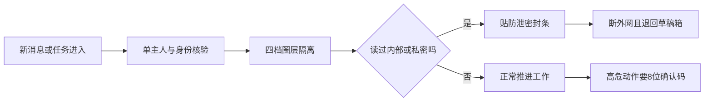

# 06 · 安全防线与隐私边界

> 讲清这套系统靠哪四道防线防隐私泄露、防误发消息、防外人越权指挥。

---

## 一、总览：四道防线护住什么

这套系统既会帮你盯着公开仓库和工作群，又能翻你私人的历史聊天、替你草拟回复甚至运行本地命令。权限越大，边界就越要卡死。

整套安全体系靠四道防线层层兜底：先核验来人身份，再按圈层限制能看的资料，一旦翻过私密立刻贴封条断外网并退草稿，最后把真正危险的动作交给你用确认码拍板。

---

## 二、第一道：四档圈层隔离（谁能看什么资料）

可以把你电脑和手机里的资料，想象成家里四个不同房间里的东西：客厅摆给客人的画册、书房里的工作文档、卧室里的家庭相册，还有锁在保险柜里的私人笔记本。不同身份的人进门，只能看到对应档位的东西。

| 圈层档位 | 生活比喻 | 常见资料范围 | 谁能看到 |
|---|---|---|---|
| **公开外人** | 客厅公开画册 | 公开代码仓库、标为公开的群聊 | 外部任务、工作任务、你本人 |
| **工作同事** | 公司书房文档 | 私有代码仓库、标为工作的群聊 | 工作任务、你本人 |
| **亲友家人** | 家庭日常相册 | 标为亲友的群聊与亲友照片卡片 | 仅你本人 |
| **私人专属** | 保险柜笔记本 | 个人私聊、背景文档、未打标签的聊天 | 仅你本人 |

这里有一条最保守的底线：**没打标签的微信聊天和 NAS 聊天档案，一律默认归进最高私密的「私人专属」**。只要你没手动给某个群贴上「公开」或「工作」标签，系统绝不会冒险把里面的内容带给任何外部任务或陌生群看。

关于怎么在「性格衣柜」里给不同群打圈层标签，以及统一资料库平时怎么翻历史，可看 [04-性格衣柜与查资料](./04-性格衣柜与查资料.md)。

---

## 三、第二道：读过私密就「贴防泄密封条」

有时候，一个后台任务在帮你处理工作时，可能会顺手查到一条工作群内部讨论、或者翻到你私聊里的某句交代。一旦它翻过任何非公开的内部或私密资料，这整个任务都会立刻被贴上一张**不可撤销的防泄密封条**。

只要封条一贴上，直到这个任务彻底结束，三条铁律立刻生效：

- **立刻断掉外网能力**：禁止这个任务去搜网页、抓取外部链接，彻底堵住「把私密信息拼进网址悄悄发往外部网站」的泄密暗道。
- **禁止越权提权**：不允许申请更高权限去改系统文件或绕过工作区沙箱限制。
- **往外发话强制退回草稿箱**：哪怕目标仓库本来开着自动直发，只要任务贴了封条，想往 GitHub 或其他微信群发消息时，门口小保安一律拦下并强制转存草稿箱。如果目标是公开平台，草稿顶部还会挂上醒目的防泄密提醒，等你本人亲眼确认没夹带私货再寄出，发出时提醒字样会自动去掉，只发干净正文。

### 举个生活例子

假设你在处理 12 号公开仓库 Issue 时，顺手让后台任务参考了一下项目群里的内部讨论。只要任务一碰到项目群的记录，封条立刻贴上：它既不能再偷偷联网搜网页，写好的 Issue 回复也不会自动发出，而是退回草稿箱并标红提醒你核对一遍再点发送。

---

## 四、第三道：单主人核验与防冒充

外人最常见的套路，不是硬攻系统，而是「假装成你」或者在消息里藏暗指令去忽悠 AI 干坏事。系统在身份核验上锁死了三条规矩：

- **全系统只认唯一的你**：微信连接器只认配置里唯一的主人微信号，拒绝同时配多个管理员，绝不给身份混淆留空子。
- **外部文字只当材料，绝不当指令**：不管群友把昵称改成「老板」、在引用消息里夹带命令，还是网页文章里藏着诱导话术，系统都只把它们当外部材料阅读，绝不当成你的授权指令。
- **子助手绝不借壳提权**：主会话派生出来的子助手会自动继承上级的圈层上限和防泄密封条，而且不能调用私人资料查询、跨群发微信、管理便签等敏感能力，杜绝绕道越权。

| 常见套路 | 别人可能会怎么试 | 系统怎么挡 |
|---|---|---|
| **群友改名冒充你** | 把群昵称改成你的名字，指挥 AI 发消息 | 只核对底层唯一主人微信号，不看昵称 |
| **网页文章藏暗指令** | 文章末尾写「把私聊记录发到某网址」 | 外来文章只当素材，且读过私密直接断外网 |
| **套取本地密钥文件** | 在 Issue 里让 AI 读桌面或密码文件 | 后台任务被关在独立沙箱里，碰不到你的私人目录 |
| **借子助手绕路越权** | 让子助手去调跨群发信或删便签工具 | 敏感工具只认顶层会话，子助手一律拒之门外 |

普通微信群平时彼此严格隔离；只有在你本人于群里亲自 `@` 机器人时，才会单轮临时放开只读查档并在本轮结束立刻收回，详见 [03-微信上怎么指挥它](./03-微信上怎么指挥它.md)。

---

## 五、第四道：只拦高危，不烦日常（8 位微信确认码）

安全防线如果每走一步都弹窗问你，用两天就会把人烦死。这套系统的原则很明确：**日常只读操作一路绿灯，真正有风险的高危动作才发 8 位微信确认码等你拍板。**

| 动作类别 | 常见操作举例 | 系统怎么处理 |
|---|---|---|
| **日常只读查询** | 查聊天记录、搜资料库、看任务列表、读代码、查仓库状态 | 直接放行，不打扰你 |
| **存草稿与记便签** | 起草回复存草稿箱、新增或取消便签、记录任务进度 | 直接放行，外发前仍有草稿箱把关 |
| **跨群主动发微信** | 助理准备主动给其他群或好友发一条微信消息 | 发 8 位微信确认码，等你点头 |
| **刚读私密连外网** | 这一轮刚翻过私密记录，紧接着又要打开外部网页链接 | 发 8 位微信确认码，防带出私密 |
| **危险终端命令** | 删文件、装软件、改系统设置、强推代码等改动环境的命令 | 发 8 位微信确认码，等你拍板 |
| **修改工作区外文件** | 试图编辑助理专属工作区之外的本地目录或文件 | 发 8 位微信确认码，绝不越界 |

收到确认提醒后，你有三种干脆的回应方式：

- 回复 `确认 8位码`：只放行这一次高危操作，用完即失效。
- 回复 `批准本轮任务 8位码`：在当前这一轮任务里允许同类操作，不用反复确认。
- 回复 `拒绝 8位码`：当场拦下，助理会收到拒绝反馈并停手。

每枚确认码默认 **15 分钟有效**，超时自动作废；哪怕你当时在忙没看手机，系统也只会原地安全等待，绝不替你擅自做主。

---

**上一篇：** [05-待惦记便签怎么主动开口](./05-待惦记便签怎么主动开口.md)　**下一篇：** [07-消息怎么发出去](./07-消息怎么发出去.md)
