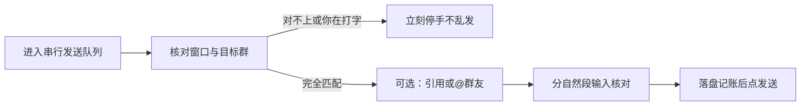
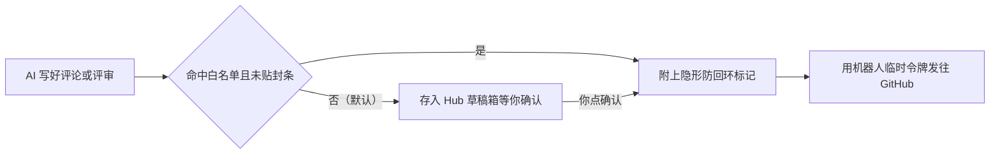

# 07 · 消息怎么发出去

> 讲清 AI 写好回复后，怎么经过草稿箱把关，再安全发到微信或 GitHub。

---

## 一、总原则：先过草稿箱，或走你的白名单

微信没有官方的发消息接口，只能像真人一样在 Mac 上看屏幕、点鼠标、敲键盘；GitHub 有官方接口，直接寄一封网络请求就行。

不管走微信还是走 GitHub，所有往外发的消息都必须经过总控台门口的小保安把关：

- **默认先存草稿箱**：外部平台的评论和代码审查默认一律先放进 **Hub 草稿箱**，等你在网页侧边栏亲眼看过、点下确认才真正发出。
- **白名单范围可直发**：只有你在面板里明确放行的范围，常规回复才会直接发出去，例如配置了 `autoSendOwners` 或开启自动直发的仓库，以及打开了自动回复的微信聊天。
- **贴封条强制退草稿**：哪怕目标在白名单里，只要这次任务翻过内部或私密资料，门口小保安依然会强制退回草稿箱等你点头，详见 [06-安全防线与隐私边界](./06-安全防线与隐私边界.md)。
- **先记账再发出，绝不盲目重发**：真正点下发送前，系统会先记一笔「正在发送」。万一中途断网、弹窗报错或电脑重启，开机后会把悬而未决的记录标为「待核实」，绝不会自动再发一遍导致刷屏。

AI 写完回复后，可以交出文字、分段消息、图片或表情包，也可以判断此刻没必要接话而选择不回：

| 想发什么 | 实际效果 | 安全限制 |
|---|---|---|
| **普通文字** | 完整发送一段回复 | 超长内容自动按自然段拆成多条 |
| **本地截图** | 可先发说明文字，再紧接着发图 | 仅限常见图片格式且体积受控，核对文件头 |
| **表情包** | 从已登记表情库里挑一个发出 | 一次一个，发不出去自动改发文字 |
| **选择不回** | 保持安静，不打扰聊天 | 记录已阅，避免无意义水群 |

---

## 二、发微信怎么既自然又不发错人

用电脑模拟真人发微信，最怕三件事：两条消息抢鼠标发串群、窗口没对准乱发、或者引用点歪发出一堆残缺草稿。微信连接器用一套严密的串行核对流程把这些坑全堵上了：

- **严格排队，一次只发一条**：整台挂微信的电脑共用一条发送队列，主动提醒和群聊回复挨个排队发，绝不会两条消息同时打架发串群。
- **动手前反复核对窗口**：发之前先确认电脑没锁屏、输入框里没有你正在敲的字、当前打开的聊天名字和目标群一字不差。如果列表被浮窗挡住会先安全切到搜索定位，任何一步核对不对立刻停手，绝不瞎发。
- **原生引用与原生 `@` 群友**：想引用某条原消息时，会先把微信主窗口抬到最前，定位原消息后核对右键菜单里的「引用」按钮。万一界面有变化找不到或担心误触，系统会自动取消并检查清空自己留下的草稿，安全降级成普通回复，绝不把半截废话发出去。需要 `@` 群友时同样会核对候选项再点选，发出真正的微信高亮提醒。
- **长消息自动按段拆发**：超过一屏的长回复会自动按空行、换行或句末标点拆成多条短消息顺次发出，不会生硬拦腰截断；也可以先发文字说明，再紧接着发一张本地截图。

---

## 三、双机模式：Mac mini 挂微信，主力机远程操控

很多人会用一台一直开着机的 Mac mini 专门挂着微信小号，自己平时则在另一台笔记本上写代码、看网页。微信连接器原生支持单机和双机两种连法：

| 使用场景 | 怎么连 | 特点与防呆保护 |
|---|---|---|
| **同机直连** | 总控台和微信连接器跑在同一台 Mac mini 上 | 同进程内部直连，延迟最低 |
| **双机远程** | 主力机跑总控台，经安全隧道连 Mac mini 桥接端口 | 同样支持发文字、发截图、核对主人身份，带令牌校验 |

这里有一条硬安全底线：**系统明确禁止连接主力机个人微信的本地监听端口**，默认也拒绝直连外部非回环地址，并且发信前会核对登录的微信是不是指定小号，彻底杜绝误操作你本人的日常个人微信。

---

## 四、发 GitHub 怎么像真人、不自己跟自己吵

GitHub 这一侧不用占着屏幕，电脑锁屏也能在后台稳稳发完。你在侧边栏的「GitHub」面板里就能随时修改策略并立刻热生效，不用重启服务：

- **读和写分开，用独立机器人发声**：拉取动态只需要只读权限，而发评论和代码审查推荐绑定独立的 GitHub App 机器人。每次发言都会自动换取短期临时令牌，以机器人身份出面；就算审查你自己提的 PR，也能正常点「通过」或「请求修改」，不会因为同账号权限被拒。
- **三重防回环，绝不自己跟自己吵**：每条由连接器发出的评论末尾都会藏一行肉眼看不见的隐形标记，同时记进本地自发台账，加上系统天然跳过机器人自己的账号动态，下次轮询绝不会把自己发的话当成新问题再回一遍。
- **按仓库切换说话风格**：可以在「GitHub」面板里指定一套全局默认性格卡，也可以给不同仓库单独绑定不同性格卡，比如对外开源项目严谨克制、自己小项目轻松随和，点一下就能跳去「性格衣柜」微调。

---

## 五、一眼看懂：发微信 vs 发 GitHub

| 对比项 | 发到微信 | 发到 GitHub |
|---|---|---|
| **发送方式** | 模拟真人看屏幕、点鼠标、敲键盘 | 调官方网络接口后台直寄 |
| **默认把关** | 已开启的聊天按规则发，跨群主动发过确认或草稿 | 默认全部先进草稿箱，白名单仓库可开启直发 |
| **电脑占用** | 需要挂微信的 Mac 亮屏，你一打字它就让 | 全程后台静默，锁屏也能发 |
| **并发能力** | 全局串行排队，一次只发一条 | 多个仓库同时并行发出 |
| **防死循环** | 核对小号身份，跳过自己发的消息 | 隐形标记、自发台账、机器人跳过三重兜底 |
| **中途断电重启** | 标记「待核实」，绝不自动重发 | 标记「待核实」，绝不自动重发 |

---

**上一篇：** [06-安全防线与隐私边界](./06-安全防线与隐私边界.md)　**下一篇：** [08-安装部署与日常维护](./08-安装部署与日常维护.md)
